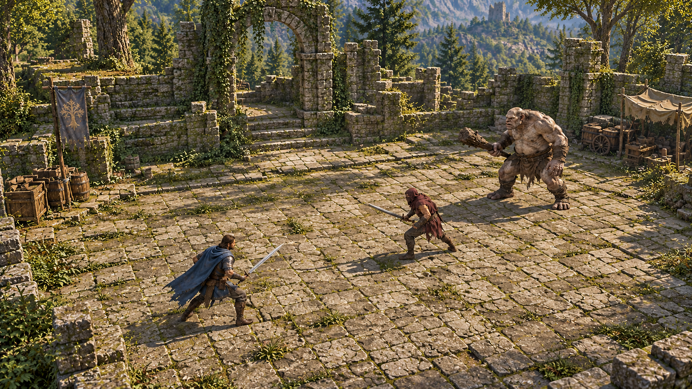

# 原创游戏设计清单

版本：0.2（首轮收敛）  
整理日期：2026年10月24日  
更新日期：2026年10月26日  
用途：作为原创游戏后续设计、原型验证与首版范围控制的依据。

当前定位为低科技剑与魔法幻想动作角色扮演游戏。单人体验完整，战斗挑战优先，装备养成与探索提供持续游玩的动力。现有 DNF 复刻内容保持暂停，保留作参考；原创游戏采用独立新工程，当前仍处于设计整理阶段。

本文中的“已确认”表示设计方向已在讨论中确定，不代表已经实现；“暂定”表示用户明确保留后续调整空间。尚未确认的技术与内容选择集中列在末尾。

当前阶段入口：[设计收敛与首轮验证清单](设计收敛与首轮验证清单.md)。其中区分整体愿景、首批验证、首版待定范围与后续扩展，列出尚未执行的验收场景。具体玩法规则仍以本文为主要记录。

## 游戏定位与初版范围

### 已确认方向

- 完整单人体验。
- 战斗挑战优先，其次是养成搭配与探索发现。
- 支持重复挑战、获取素材、制作装备和练习打法。
- 成长有明确上限，达到上限后仍可尝试不同职业、装备、技能和挑战。
- 初版目标平台为 Windows PC。
- 手柄优先设计战斗，键鼠完整适配。
- 网络合作、PvP 和联网专项验证均移出初版范围。

### 当前阶段与范围收敛

2026年10月26日阶段评估：本轮设计梳理约完成60%，可按55%～65%的粗略区间理解。这是依据方向清晰度、关键未决事项和原型交接准备作出的主观里程碑估计，不按文档长度或已回答问题数量计算，不代表游戏制作完成度。原创工程尚未创建，核心战斗与资产流程尚未通过新原型验证。

| 分类 | 当前内容与处理方式 |
| --- | --- |
| 核心目标 | 完整单人体验；中速、有分量的战斗；人形与巨兽；站位与部位打点；职业流派、固定装备养成及重复挑战。这些用于判断取舍，不表示首个原型一次实现全部系统 |
| 首批验证 | 基础剑士、一个人形、一个巨兽、小试验场，验证镜头、操控、攻防与反馈；另尽早用小样检验环境反应及角色／装备／动画资产链 |
| 下一轮验证 | 在核心战斗成立后，串联小范围探索、战斗、素材、制作或升级、再次挑战的短循环 |
| 首版覆盖待定 | 五大陆实际开放地区、四职业及各物理魔法专精、出身序章、剧情章节、环境模拟覆盖、装备和生活内容量；先确定范围，不默认为全部首版完成，也不自动删去已认可的设计方向 |
| 明确后续 | 联机合作与PvP、完整居民作息等时间模拟扩展；初版不加装备耐久，后续再评估 |
| 暂缓讨论 | 武器细分表及新增推荐保留为草案；长剑与大剑共享基础模组、同一物理专精内可战斗切换的原则保留 |

下一步收敛顺序建议为：首个原型边界与验收标准、首批角色及敌人的具体动作、关键资产与技术验证，再据结果细化首版可玩区域和内容量。无需等待全部大陆历史、剧情台词或所有武器数值完成后才验证；当前仍仅进行设计整理，不自动启动开发。

### 整体规划与早期数量基线

| 内容 | 当前规划 | 范围状态 |
| --- | --- | --- |
| 职业战斗体系 | 剑士、法师、猎手、暂定御灵者，各保留物理、魔法专精 | 整体愿景；不等同于全部首版交付 |
| 世界与主区域 | 宏观五大陆，早期曾以两个主区域讨论内容规模 | 新世界规划下首版覆盖待重新确定 |
| 普通敌人 | 早期参考4～6类基础类型 | 保留作数量基线，未据五大陆扩成正式完整清单 |
| 主要 Boss | 早期参考2～3个，同时覆盖人形与怪物 | 保留作数量基线，具体首版覆盖待复核 |
| 首个打磨体系 | 参考转职前基础鬼剑士的剑术体系 | 首批验证方向已确认 |
| 第二个大职业方向 | 法师，物理战斗法师与魔法元素法师 | 剑士之后优先，专精覆盖待定 |
| 敌人变体 | 通过武器、防护、配置等扩展基础类型 | 扩展方法，不代表已承诺额外数量 |

四大职业、五块大陆是整体设计规模，不直接等同于已确认的首版完整制作量；初版职业、专精及可玩地区的覆盖需重新收敛。普通敌人与主要首领数量仍作为早期范围参考，区域面积、游玩时长和完成日期尚未确定。

## 镜头与美术

### 镜头方向

暂定采用固定观察方向、中等程度的倾斜俯看。需要兼顾地面纵深、角色前后位置与建筑立面、地形的高度感。

以下图片为用户接受的暂定镜头基准，人物、怪物、材质与场景内容仅为示意。

配套记录：[镜头方向记录](camera-direction-2026-10-24.json)。

镜头俯角、水平方向、角色屏幕占比、投影方式、跟随、缩放和遮挡处理，通过实机验证确定。

### 美术方向与素材来源

- 写实比例、风格化表现。
- 人物、怪物与建筑保留可信结构，材质与细节适当简化。
- 突出动作轮廓、装备辨识度和环境状态。
- 现成资源打底，通过改造、自制或少量定制补足特色。
- 按统一比例、骨架、材质与动画规范筛选和整合素材。
- AI 协助设计、开发、素材制作与处理。
- 素材生产按三类组合：AI直接生成、AI使用软件生产，以及对AI生成物或现有素材库的后处理。每项素材记录具体生产链。
- 用户目前没有美术技能，素材生产流程需要支持通过参考选择、预览和试玩反馈参与。
- 角色与场景的最终制作流程、渲染方式仍需技术确认。
- 验证Demo阶段暂用《怪物猎人》的模型及可用动作，优先验证本作玩法；已完成普通辟兽模型、骨架及一段原作动作的Blender导入与播放验证。人物角色模型后续再获取与验证，此次不启动提取。临时素材不决定正式职业、怪物和美术设定，正式素材生产路线后续再定。

素材类别、生产路线与首批验证样本详见[素材类型与生产建议](素材类型与生产建议.md)。验证Demo的临时素材路线已选定，正式素材来源、完整工具链与数量仍待确定。

## 基础战斗与动作系统

### 节奏与动作承诺

- 地面移动、转向与出招支持任意方向，以角度、距离和绕行形成站位选择。
- 追求每次攻击的分量、明确的命中反馈和有意义的站位。
- 不以长时间控制敌人后连续输出大量招式为战斗核心。
- 轻攻击较灵活，重攻击更有承诺；具体取消窗口逐招设计。
- 可以主动跳跃，具有少量空中攻击和职业技能。
- 战斗主体在地面，不围绕长时间滞空与空中长连段组织。

### 短暂预输入

- 已选择 A：支持短暂预输入，在当前动作允许衔接时执行近期的一次有效操作，不连续排队多个动作。
- 预输入不会提前取消攻击，也不越过动作承诺、受击硬直或资源限制；执行时仍需满足对应动作条件。
- 缓冲时长、不同输入的覆盖与优先级、失效条件待原型验证，避免过期输入在意外时机触发。

### 动作体系的三层结构

| 层次 | 内容 |
| --- | --- |
| 基础动作 | 普通攻击、重攻击、移动、跳跃与各职业的基础防御动作 |
| 动作派生 | 通过按键顺序、交替、蓄力、方向和时机进入不同动作 |
| 装配技能 | 通过技能组切换扩充可调用技能，提供职业特色与战术选择；具体槽位数量待定 |

此前约3～4个主动技能作为单组装配参考；本轮明确双组用于扩充技能栏，每组槽位与总出战技能数量需据此重新确定，不默认仍限制总共3～4个，也不直接确定每组均为3～4个。基础动作及其派生另行提供可用动作。

操作参考包括 C 技式按键派生，以及《怪物猎人 崛起》式基础动作配合少量独立技能的整体结构。重点是根据敌人状态、距离和部位选择动作。

### 首个战斗体系

参考转职前的基础鬼剑士，以剑术和基础动作派生为主体。职业名称、力量来源、具体招式表、武器形制和后续发展方向待设计。

该参考不自动确定任何原作名称、角色造型或具体技能配置。

基础攻击输入已选择 A：至少轻攻击、重攻击两个独立按键，可蓄力的重击通过按住重攻击发动。2026年10月26日再次选择 A：第三个独立特殊攻击键先预留，首轮先验证轻、重、蓄力及基础攻防，再根据试玩暴露的需求决定是否加入与具体功能。若后续采用，按此前方向单按触发；不要求用该键替代已确定的两页技能，也不提前定义为职业机制或独立强力攻击。

第一套基础剑士普通攻击已选择 A：每按一次执行一次攻击或推进一段，不以持续按住自动重复攻击；仍遵守短暂预输入和动作衔接规则，不由本项统一规定其他职业的持续射击或引导动作。

基础轻攻击以三段短连击为起点，同时允许轻攻击、重攻击、蓄力及特殊攻击（若采用）按具体招式规则连携，整体参考怪物猎人的动作派生思路，不限定为只能重复一套固定三连。具体连携表、取消窗口与专属动作仍待设计；不因此允许任意取消，也不要求敌人持续硬直。

### 第二个职业方向

- 已确认整体方案：第二个大职业采用法师，共同基础后发展为战斗法师与元素法师等专精；不将全部法师限定为远程吟唱职业。
- 基础法师接触少量法器近战、简易魔法弹、基础元素法术、通用闪避与可选防御法术，为两种距离的战斗和后续专精提供体验；初期不要求完整制作两套近战、远程动作库。
- 推荐制作顺序已认可：基础剑士先打磨，再制作基础法师与元素方向，随后补战斗法师。元素方向先验证远程、吟唱、移动施法及环境互动；各专精的具体首版覆盖仍需单独收敛。
- 大职业数量与完整可玩战斗体系数量分别统计：剑士、法师若各有两个完整专精，实际需要分别打磨四套战斗体系，不能只按两个大职业估算工作量。
- 初版先提供少量代表技能，具体原创名称、力量来源、动作与法术清单及数量待设计；不要求所有法术都能移动施放。
- 本项确定设计与制作方向，不代表已经实现。

### 法师的主要专精

| 维度 | 战斗法师 | 元素法师 |
| --- | --- | --- |
| 核心体验 | 有节奏的法器近战，穿插魔法强化与释放 | 观察站位，选择法术与释放窗口 |
| 主要伤害成长 | 物理攻击 | 魔法攻击 |
| 推荐武器方向 | 战斗用长柄法器，如矛、棍 | 施法用法杖、魔杖 |
| 主要距离 | 近距离，部分招式覆盖中距离 | 中距离，保留近身应急手段 |
| 资源侧重 | 有效命中的收益更明显 | 自然恢复更重要，进攻提供补充 |
| 主要风险 | 近身与出招承诺 | 吟唱、瞄准及释放后的收招 |
| 可选防御方向 | 近战招架、护身或撤步法术 | 屏障、闪现或控制法术 |

- 战斗法师保持整体中速、有分量的动作设计，不以高速长连段为核心。魔力球、符印等可融入特定攻击、派生或主动技能，不要求每次普攻后额外按一次发射键。
- 魔力表现不强制使用魔法攻击成长；战斗法师多数主要技能可统一按物理攻击成长，混合或特殊伤害逐招明确，避免正常输出必须同时堆物攻、魔攻。
- 元素法师采用快速小法术、中等准备的常用法术和利用明确窗口释放的长准备强法术，避免仅在远处等待大型法术冷却。
- 不同元素可进入同一套加点与技能页，不先将火、冰等分别拆成独立专精。两专精的正式名称、武器适性、具体技能与数值仍待设计。

### 法师技能演化与后续预留

- 沿用既定规则：专精开放演化资格，具体技能投入技能点达到节点并满足条件后才演化；不因转职自动替换全部基础技能。
- 简易魔法弹可演化为配合近战的追击弹或可蓄力的元素弹；魔力冲击可融入法器攻击或区域法术；防护法术可侧重近战护身或施法空间。这些仅是说明结构的候选例子，不作为已锁定技能清单。
- 不要求每个基础技能都有两个演化版本，允许保留通用用途或由专精新增技能接替。觉醒沿当前方向强化，不继续分叉。
- 战斗中仍仅切换当前专精内的武器与技能页，跨专精切换在营地整备完成，不因法师分支而改变既定规则。
- 后续候选保留咒术师、炼金或仪式法师，仅预留方向，不承诺全部制作或进入首版。原先将召唤师列为法师后续方向的记录，需结合御灵者独立为大职业重新划分。
- 职业边界建议为长期灵性伙伴与协战主要由御灵者承担，法师可保留短暂召唤效果，具体归属待设计；不自动同时制作两套高度重复的召唤专精。
- 咒术方向结合标记、削弱、条件触发和直接进攻；炼金或仪式方向通过媒介与场地创造施法条件，与生活制作区分，不强迫每次施法消耗背包素材。
- 各专精需具备独立完成单人战斗的能力，不以纯治疗或纯团队增益专精为当前主要方向。

### 施法者的基础进攻与资源

- 已选择 A：保留不消耗职业资源的基础攻击，使主要资源耗尽时仍可进攻；主要法术消耗职业资源，具体成本与循环待设计。
- 基础攻击性能有限，不直接替代主要法术；可以采用简易魔法弹或法器攻击等形式，具体形式尚未确定，不强制要求耗尽资源后转为近战。
- 资源恢复已选择 C：自然恢复保障基本循环，有效进攻加快恢复，兼顾观察走位与主动进攻。
- 自然恢复与进攻恢复的比例、速度、触发条件、可恢复范围及具体回资源招式待原型验证；不直接照搬基础剑士的低资源保底恢复规则，也不预设所有法术均可返还资源。
- 其他恢复手段及基础攻击的耐力规则待设计。

### 施法者的防御方向

- 已选择 C：基础依靠走位与通用闪避，特殊防御法术作为可选装技能，纳入既定技能装配与投入规则。
- 护盾、短距离闪现等为可选方向，不默认全部成为免费常驻基础能力；初版先验证一种代表性防御法术，具体选择、动作权限与资源成本待设计。
- 防御法术可形成流派差异，不要求沿用基础剑士的格挡与弹反操作。

### 移动朝向与动作权限

- 自由状态以左摇杆为主要方向输入，移动与出招可以朝地面任意方向；没有方向输入时保留最后朝向。
- 锁定保存目标，普通走位仍允许朝行进方向转身离开；出招时按动作权限朝目标调整。
- 近战出招期间由招式接管移动和转向，可以停步、踏前或使用专用撤步等位移。
- 远程、吟唱与持续技能可以逐招配置移动施放；此时可面向目标后撤或侧移，结束后恢复自由移动。
- 移动、朝向、承诺点、取消、资源与目标丢失策略按动作阶段配置，具体参数与特殊情况待验证。

本轮统一方案与验收场景见[移动朝向与动作权限方案](移动朝向与动作权限方案.md)。

## 锁定与部位命中

### 锁定规则

- 不锁定时，按玩家输入的方向攻击。
- 主动锁定可以提供朝向修正与有限攻击辅助。
- 锁定目标与身体朝向分别处理，不要求普通走位时一直面对目标；施放中的瞄准姿态按当前招式决定。
- 人形只锁定主体，不允许切换锁定部位。
- 大型怪物支持选择与切换指定部位。
- 锁定用于表达攻击意图，实际命中仍由攻击范围、轨迹与接触部位决定。
- 部位高度和可达性仍然有意义。锁定高处弱点不会直接保证近战能够碰到。
- 攻击辅助的角度、距离修正与停止追踪时机，留待实机调整。
- 目标死亡后的锁定行为提供设置项：默认解除锁定，由玩家重新选择；可开启自动切换到附近合适目标。
- 自动切换不使已经挥出的攻击突然改变方向；目标筛选范围、优先级及后续动作采用新目标的时机待验证。本项不直接决定遮挡、超距或怪物锁定部位失效时的处理。

### 部位肉质

人形、怪物与玩家角色都采用部位承伤差异。这里的“肉质”表示不同身体部位及防护状态，对攻击具有不同承受能力。

- 命中裸露头部等弱点，可以获得较高伤害。
- 盔甲、甲壳、鳞片等影响对应部位的防护。
- 外观应尽量传达可理解的攻击收益。
- 人形锁定主体时，实际碰到头、躯干或其他部位，仍按对应部位计算。
- 锁定目标、实际命中部位、部位伤害与部位破坏分别处理。

部位破坏对战斗与素材奖励的方向见下文，具体部位及效果逐个敌人设计。伤害类型与肉质的具体对应、倍率及计算方式待设计。

### 基础战斗属性体系

- 暂定采用 B：物理攻击、魔法攻击及对应物理防御、魔法防御分别配置，元素和异常另行处理。
- 角色基础属性仍随成长自动提高，暂不增加力量、智力等进一步推导战斗属性的层级，也不因此增加手动属性加点。
- 装备自身属性保持固定，不随角色等级自动缩放；实际效果结合角色能力、技能与目标部位等计算。
- 具体属性清单、混合伤害公式、防御计算及元素与物理魔法的关系待设计，允许后续验证调整。

### 职业伤害方向与元素组成

- 已认可物理、魔法转职各有主要成长属性，多数主要技能按单一体系计算，混合伤害作为明确设计的例外，不要求所有火属性战技都拆成物理与魔法两段。
- 物理剑士主要依赖物理攻击，魔法剑士主要依赖魔法攻击；挥剑动作本身不强制伤害具有物理分量，魔法火焰斩可主要或完全为魔法火焰伤害。
- 元素主要归入魔法或元素伤害部分的方向保留；明确表现为剑身命中与火焰爆发的招式可拆分，武器附加元素伤害的来源与缩放逐项配置，不默认要求物理职业同时堆魔法攻击才能正常输出。
- 魔法伤害不必须具有元素，可存在无元素魔法；技能的物理魔法分类、攻击力来源、元素性质与环境作用分别明确。
- 转职开放对应技能演化资格，投入技能点达到节点后才演化或增加对应伤害部分，不因转职自动转换全部旧技能；职业本身需提供可用的基础输出。
- 魔法防御与元素抗性的关系已选择 A：元素魔法伤害受两层共同作用，魔法防御提供通用防护，对应元素抗性进一步修正；无元素魔法仍受魔法防御影响。
- 部位肉质仍按实际命中参与，魔法不自动无视部位差异；具体技能分类、缩放、混合流派收益、防御与抗性的顺序及公式待测试，避免两层防护过强使对应攻击失去作用。

### 元素抗性 异常抵抗与环境适应

- 暂定选择 B：元素伤害防护、相关异常抵抗与环境适应分别计算，允许通过材料或装备关联提供，不由单一元素抗性自动包办全部效果。
- 保暖、隔热、燃烧抵抗与冰火攻击防护等需按实际性质设计，具体对应关系待验证，避免仅按元素名称视为完全等价。
- 分别计算不等于每项都必须成为独立装备词条或面板数值，部分能力可由材料属性决定；具体属性、反馈与界面展示待设计。

### 命中判定与概率闪避

- 已选择 A：不设置攻击实际接触后的额外随机未命中或属性概率闪避判定。
- 攻击范围、轨迹及实际接触决定命中部位与结果，格挡、弹反、无敌等按明确规则分别处理。
- 敌人灵活性通过实际移动、闪避和防御动作体现，不另设命中率属性作为已命中的二次否决。
- 已确定的概率暴击保留，影响命中后的伤害，不决定该次实际接触是否算命中。

### 概率暴击

- 已选择 A：加入独立的概率暴击机制，装备或属性可以提供暴击率，触发后增加伤害。
- 与既定的固定装备属性、无随机词条并存；战斗中概率触发不等于装备获取时随机洗属性。
- 暴击率来源、上限、伤害倍率、适用攻击类型及与部位弱点、防护、持续伤害等的计算关系待设计。
- 与部位弱点的关系已选择 A：可以叠加，命中弱点获得对应收益的同时，该次攻击仍可触发暴击；具体公式和倍率待测试，不直接确定连续乘算方式。
- 伤害数字中的暴击表现与既定可配置显示共同设计，不替代实际命中反馈。

### 部位破坏的战斗影响

- 已选择 B：关键部位破坏产生符合身体或防护结构的对应变化，不要求所有部位都改变动作与行为。
- 每只首领先设计少量关键部位；破甲露出弱点、断尾缩短攻击范围、破坏器官削弱特定能力均为候选示例，不要求每只怪物具备相同部位或效果。
- 破坏应让玩家的打点选择改变战局，同时保留敌人破坏后的反击能力与战斗价值，不以破坏后完全失去威胁为默认结果。
- 具体部位、可重复性、视觉表现及与招式、防护、移动、失衡的关联待逐个设计。
- 人形与玩家是否采用对应的破坏机制另行讨论，不因大型怪物方向自动确定肢体损伤或装备破坏。

### 人形敌人的部位破坏

- 已认可 B：部分人形敌人的关键装备或防护可以破坏，改变对应防护或招式；不要求所有人形敌人都有可破坏部位。
- 头盔、盾牌、护甲等为候选，具体敌人的破坏目标、效果与表现分别设计；本轮不加入通用肢体损伤系统。
- 人形仍只锁定主体，实际接触部位决定伤害与破坏进度，不增加头部或肢体锁定切换。
- 敌人战斗中的防护破坏不自动决定成品掉落的损坏、装备耐久或维修规则。
- 玩家已选择不采用战斗中的装备或防护部位破坏，具体规则见下文。

### 玩家装备破坏 耐久与战斗磨损

- 玩家已选择 A：不采用装备部位破坏。保留部位承伤差异、受击、耐力破防和倒地，头盔、盾牌等不因对应部位受击破坏而失去能力。
- 初版不加入装备耐久消耗与维修机制，后续再评估，不作为已承诺的后续功能。
- 可以随战斗出现划痕、污损、血渍等外观表现，不影响装备属性与行动能力，也不意味着引入耐久值。
- 外观磨损的覆盖范围、叠加方式、持续时间、清理及休整后是否重置待设计。

### 部位破坏与素材奖励

- 已选择 B：破坏部位提高对应素材的获取效率，可通过提高数量或概率实现；具体奖励方式与数值待设计。
- 对应素材仍保留较低效率的其他获取途径，避免不擅长处理该部位的职业无法完成关键装备培养。
- 击败奖励、兑换等作为替代途径的候选，具体来源与成本待设计；不预设所有素材都使用同一种替代机制。
- 部位破坏对战斗行为的影响另行确定，不因奖励规则自动确定断尾、削弱招式或肉质变化。

### 伤害类型与防护克制

已选择 B：克制具有明显收益，同时保留不匹配时的可行打法。

- 伤害类型与敌人部位、防护或抗性的匹配会明显影响战斗收益，鼓励战前准备和装备选择。
- 不匹配时，仍可通过寻找弱点、打点、破防及熟练操作有效应对；各职业保留独立完成主要内容的路径。
- 不以普遍强制更换职业或特定武器类型作为主要内容的通行条件。
- 具体斩击、突刺、钝击及元素分类尚未定案；此前重甲缝隙、甲壳和火焰抗性的例子用于说明方向，不代表已经确定具体机制。
- 环境元素反应与伤害抗性分别配置，具体关联待设计。

### 战斗中的武器与技能组切换

- 本轮明确同专精内多配置为确定需求：战斗中可切换武器或一组技能，配置也可以使用相同武器，不只是更换武器模型或面板。
- 本轮澄清主要目的是扩充技能栏，并可结合不同武器特性增加应对方式，不是两套拥有独立加点预算的完整流派随时互换。
- 职业与武器采用擅长或推荐类型的软关联。本轮已明确剑士长剑与大剑共享基础攻击模组，主要通过速度、动作时长、伤害和手感参数区分，可在同一物理专精内战斗切换，不为此拆分职业。
- 武器流派由武器性能、技能选择、加点与具体装备共同形成。大剑偏蓄势重击、长剑偏剑术派生与应对，不因换武器自动获得另一套加点、职业资源或基础防御机制；少量武器专属效果仍可逐招设计。
- 其他武器子类的战斗切换按动作与技能兼容性设计；共享模组不要求所有参数完全相同，也不代表弓弩、重兵器与法器等外形不同的武器可直接复用全部表现。
- 已认可技能组与武器不强制绑定：同一把武器可以使用两页技能，更换兼容武器也不必强制更换技能页；具体输入及可选联动配置待设计。
- 同职业内两组共用一套技能加点与总技能点预算；同名技能的等级及演化版本一致，不因换组重分技能点或叠加两套强化收益。
- 先前将双配置仅列为后续考虑的范围需据此更新；核心战斗验证仍可先制作一套配置，初版交付的具体配置数量与切换覆盖范围待确定。
- 一套配置可包含主武器、盾牌或副手及相应技能选择；具体切换内容、成本、时机、资源与冷却处理待设计。
- 宏观规则本轮统一为：战斗中不切换职业，限定当前职业及专精内的武器与技能组配置；跨专精与跨大职业的切换放在营地整备，不通过战斗内配置切换更换整套职业身份。
- 战斗内是否共用全部防具、珠子及其他装备，具体配置槽位与切换范围仍需设计，不自动确定支持全身装备瞬间更换。
- 独自战斗为主的方向保持，未决定改为常驻小队游戏；双武器不自动认定为双职业。

## 防御与战斗资源

### 防御方向

采用共同的基础避险手段，主要防御方式随职业变化。

玩家可以通过观察和走位处理常见攻击。职业可以分别突出格挡、弹反、闪避、特定承受攻击的招式、距离或防护能力。具体能力不要求全职业相同。

基础防御方式主要由职业与技能决定，具体武器可按固定属性或特色效果修正性能；同类武器更换不自动带来另一套完整防御机制。

### 弹反暂定规则

- 可以处理较多直接攻击，包括人形武器攻击和部分怪物招式。
- 根据招式性质判断能否弹反，体型与物种不直接决定全部结果。
- 需要面对来袭方向；具体有效范围待定。
- 普通弹反无法直接处理抓取、持续伤害区域等所有威胁。
- 对巨兽成功弹反可以化解当前攻击、积累失衡，但不必立即打断整只怪物。
- 连续攻击需要分别处理，成功一次不自动消除整个连段。
- 保命、打断、失衡与反击伤害分别设计。
- 反击仍遵守距离、实际接触与部位肉质。
- 走位可以带来弱点位置、安全路线和后续攻击窗口等独立收益。

第一套基础剑士的操作已选择 A：普通格挡与弹反共用防御键，按下时提供短暂弹反窗口，继续按住则保持普通格挡。其他职业可以采用自己的防御机制，不要求统一使用此操作。

弹反成功后的反击已选择 A：提供短暂反击派生机会，由玩家按攻击主动发动，不自动播放反击。玩家也可以选择走位、使用技能或继续防御，具体衔接窗口与动作权限待验证。

反击仍需满足距离与实际命中条件；弹反成功不保证敌人必然硬直，也不保证反击安全命中。

共用按键不改变招式能否弹反的分类；具体窗口、连续点按的限制、失败后能否转入普通格挡及资源成本待设计。

提示方式、具体招式分类与失败结果仍为待定细节。

### 普通格挡与削血

- 已选择 B：具备格挡能力的职业，成功格挡普通攻击可完全免除生命伤害；部分强攻击或防御性能不足时可产生少量削血。
- 普通格挡继续消耗耐力，耐力不足触发破防；能否格挡、削血量及耐力消耗按招式与职业防御能力设计。
- 技能和装备可改善防御性能，具体是否能消除某类削血待设计；不要求所有职业具备相同格挡能力。
- 本项针对普通格挡，弹反的效果及资源成本另行处理。
- 格挡移动已选择 B：保持防御方向时可慢速后撤或侧移，后撤输入不要求转身露背；快速撤离需解除格挡、闪避或收武器奔跑。
- 具体防御朝向控制、转向速度、移动速度及格挡中的耐力恢复规则待验证，不要求各职业使用相同参数。

### 基础闪避

- 已选择 A：基础闪避同时提供位移与短暂无敌，玩家可以结合站位、距离和发动时机处理攻击。
- 无敌仅覆盖部分动作阶段，不覆盖完整闪避动作；具体窗口、位移、收招和转向待原型验证。
- 无敌可规避的攻击范围与特殊例外待设计，持续区域伤害不会因避开一次就永久失效。
- 继续遵守既定耐力消耗、耗尽限制及受击后不能用普通闪避主动脱身的规则。

### 资源方向

基础攻防与职业资源分开。

- 普通攻击通常不消耗统一体力。
- 奔跑、翻滚与防御使用耐力约束，具体规则见下文；消耗与恢复数值待验证。
- 职业通过自己的行动获取、使用资源，形成不同循环。
- 弹反、动作派生、技能与资源的关系需要一起验证。

### 主动技能的使用频率约束

- 已选择 C：以职业资源为主，部分技能另设限制。
- 常用主动技能主要通过资源消耗、动作风险与使用时机约束，少数强力技能可增加冷却、次数或特殊发动条件。
- 不要求各职业使用同一种资源，也不要求所有技能同时消耗职业资源、耐力并进入冷却。
- 广域控制、强力保命等为需要额外限制的候选，不预设每个具体招式的成本；各职业资源循环、技能清单及数值待设计。

### 主动技能的资源扣除时点

- 已选择 B：普通主动技能在攻击或法术正式释放时扣除职业资源；准备阶段被打断不扣，正式释放后即使打空也消耗，适用于剑士战技与法师法术等。
- 正式释放以招式配置的释放事件为准，不以命中敌人为扣除条件；具体事件时点逐招确定。
- 持续施法可按持续时间或效果次数消耗，具体扣除节奏与资源不足时的终止行为逐招设计。
- 本项仅确定职业资源扣除，不自动决定冷却起算、耐力消耗、技能取消窗口或道具扣除规则。

### 第一套基础剑士的职业资源

- 主要来源已选择 A：有效进攻积累，基础攻击、特定派生等有效命中提供资源，用于主动技能，具体招式与数值待设计。
- 允许开场预存资源，不要求每场战斗从空资源开始；初始量、预存来源、上限与是否休整补充待定。
- 自然恢复范围已选择 B：低资源时恢复到一定保底量，更高储备主要靠有效进攻积累；开场预存可以高于保底线。
- 自然恢复用于提供重新组织进攻的空间和难度容错，具体保底量、恢复速度与条件待验证，不预设达到保底后继续被动恢复至满。
- 准确防御、弹反或命中特定破绽提供额外资源为候选，不将弹反确定为唯一有效来源。
- 资源名称、设定解释、脱战保留、空挥收益及技能能否返还资源尚未确定。
- 本项针对第一套基础剑士，不要求其他职业采用相同循环。

### 耐力与耗尽反馈

本轮确认方向（2026年10月25日）：

- 战斗状态下奔跑持续消耗耐力；脱战状态下奔跑不消耗耐力。战斗内奔跑濒临耗尽时，角色逐渐表现出无力与喘气，提醒玩家主动停跑；是否实际降低速度及其幅度待验证。
- 战斗内持续奔跑直到耐力彻底耗尽，可以触发短暂强制喘息，期间暂时无法自主行动。
- 翻滚单次消耗耐力；翻滚耗尽耐力后，完成当前翻滚，无法继续翻滚，并进入喘气状态。
- 翻滚耗尽后的喘气具体限制哪些其他行动、持续多久，以及耐力不足但尚未为零时能否发动最后一次翻滚，仍待明确。
- 防御主要在承受攻击时扣除耐力；承受攻击导致耐力不足以维持防守时，触发破防受击。单纯保持防御可限制耐力恢复，具体恢复规则待验证。
- 停止消耗耐力的行为后，耐力恢复；恢复延迟、恢复速度、喘息结束条件及恢复量待验证。
- 基础攻击通常不消耗耐力；部分特殊动作或持续状态可按动作配置消耗。
- 耐力透支喘息、受击破防与普通受击硬直分别处理。耐力充足仍可能被重击击倒，耐力耗尽也不直接让所有轻攻击变成击倒攻击。
- 低耐力预警必须先于完全耗尽，具体动画、呼吸声与界面提示待设计。

本轮不自动引入随时间下降的耐力上限或食物补充上限规则。奔跑与翻滚的耗尽规则分别配置，不预设所有耐力消耗行为都会触发相同喘息。

### 收拔武器与机动

- 明确区分持武器与收武器状态，喝药及使用道具前需要先收武器，必要的收武器过程具有动作时间。
- 收武器奔跑收益已选择 A：速度更快，战斗内不因收武器额外降低奔跑耐力消耗；具体速度差及消耗数值待试玩验证。
- 脱战奔跑不消耗耐力，与是否收武器分别判断；收武器的速度收益在探索中仍有作用，具体差异待验证。
- 收武器不等于脱战，锁定、战斗状态与收拔状态分别处理；短暂拉开距离仍可属于同一遭遇，战斗判定需与既定脱战规则一致。
- 用道具输入已确定自动串接收武器：持武器时按喝药或道具键，先完成收武器，再进入对应使用动作；收武器的准备时间保留，已收武器时无需重复收起。
- 已选择 A：提供手动收武器操作，允许玩家提前准备撤离、赶路或使用道具；同时保留用道具时自动收武器的衔接。
- 收武器状态下按攻击已选择 A：一次输入直接衔接拔武器攻击，保留必要的准备时间；具体动作按职业设计，不默认附加额外伤害加成。
- 具体按键、是否提供独立手动拔武器操作，以及收拔的取消、打断和与其他攻击或技能的衔接规则待定。
- 脱战奔跑期间能否同时恢复耐力、途中进入战斗时的提示和耐力消耗切换待验证。

### 受击 硬直与累计失衡

本轮基本认可的设计方向，具体参数与敌人配置待原型验证：

- 玩家、人形敌人与大型怪物共用受击判定框架，分别配置参数。单次受击反应取决于攻击冲击力与反应类型、命中部位及防护、当前动作阶段的抗打断能力。
- 命中反馈与控制效果分开：即使无法打断攻击，也要有清楚的受击表现；抗打断不自动免除伤害。
- 普通人形更重视直接命中的短硬直；重甲、持盾与精英人形通过防守状态、动作破绽和累计失衡形成差异。
- 大型怪物以有战术意义的部位积累失衡，达到条件后触发对应的踉跄、跪地或倒地；并非所有部位都能触发同样反应。
- 单次直接打断与累计失衡可以并存；轻重攻击及不同招式具有不同冲击价值，重击也不无条件打断所有动作。
- 部位破坏进度与可重复触发的失衡进度分开。破坏进度通常在本次战斗中保留；关键部位破坏产生对应战斗变化，具体效果逐个设计。
- 大型怪物的部位失衡积累在正常交战间隔内保留，不因玩家正常躲避一轮招式就迅速恢复；脱战、特殊恢复行为的处理待定。
- 可恢复的架势机制用于防守、对招特色明确的敌人，暂不要求所有敌人都有统一的快速恢复架势条。
- 倒地提供攻击弱点、推进其他部位破坏、治疗或恢复资源等选择。首版验证候选为：同类倒地积累在倒地期间暂停，起身后进入下一轮，生命伤害和其他部位破坏仍正常结算。
- 不以持续普通攻击无限延长首领硬直为默认玩法；不同控制的衔接、起身保护与重复失衡阈值待验证。
- 未触发失衡时，通过正常招式破绽仍应能够有效输出。

### 玩家受击后的脱身与起身

已选择 A：等待受击动作结束，不提供通用的受击中紧急脱身机制。

- 普通闪避不能取消受击硬直；恢复行动权限后才能发动闪避。
- 倒地允许适当延迟起身，起身提供短暂保护；可延迟范围、保护阶段和结束条件待验证。
- 普通敌人的连续攻击不应轻易形成首击命中后全套必中的长时间控制；围攻场景需要检查连续硬直及反复击倒问题。
- 少数明确设计的连续命中招式，按整套攻击评估伤害、预警和惩罚。
- 本规则约束已经受击后的脱身；攻击收招阶段能否取消为闪避，仍由该攻击的动作权限决定。

### 阵营之间的动态交战

- 已选择 B：附近单位按阵营关系和感知情况动态交战，敌对生物或势力发现彼此后可以发生冲突，不限于一次性预设事件。
- 不要求当前阶段在整张地图或远处区域持续模拟战争；具体活动范围与持续状态待设计，不改变环境模拟的既定方向。
- 势力敌对关系、目标选择、撤退及重要剧情角色处理待设计，玩家介入后的经验、掉落与任务判定另行确定。

### 阵营冲突的奖励归属

- 已选择 B：战利品与参与奖励分开，敌人死亡后按掉落规则产生可拾取战利品，不要求玩家取得最后一击。
- 经验与挑战奖励按实际参与判断，主动攻击、控制或利用环境引导冲突可作为参与依据，具体标准待设计。
- 不因玩家仅在附近观察就默认给予完整经验和挑战奖励，也不将所有参与方式简化为伤害百分比。
- 任务按目标性质分别判定，目标死亡与亲自完成特定挑战不要求采用相同条件。
- 封闭首领战的部位奖励仍遵守胜利后统一结算，不因本项提前发放待结算奖励。

### 重要NPC的死亡与保护

- 已选择 B：关键角色有保护，其他人物按内容设计死亡后果。
- 主线必需角色应避免被普通动态冲突或意外环境危险轻易杀死，不因偶然冲突造成关键任务或基础服务永久缺失。
- 非关键人物可承担明确的死亡后果；护送、救援等任务可明确设置生命风险，不要求所有友好角色统一无敌。
- 保护可表现为撤退、失去战斗能力等，具体角色、保护阶段、复归或替代流程及服务连续性待设计。
- 玩家攻击友好角色的反应已选择 B：偶发误伤先容忍或警告，持续攻击或严重行为可触发反击、逃跑等敌对反应。
- 不要求所有NPC具有相同容忍度，警告与态度变化应清楚可见；关键角色受到死亡保护不等于无条件接受攻击。
- 敌意传播已选择 B：附近目击者和同伴可按关系、感知与职责支援、逃跑或报警，不因一次普通误伤自动让整个势力或其他地区敌对。
- 更广泛的势力关系后果由明确的重要行为或任务事件设计，具体目击、支援、持续时间及和解规则待定。
- 敌意解除已选择 B：正式脱战后结束即时追击，但关系损害不自动清除；轻微误伤未升级为冲突时可较快恢复，持续攻击等造成的敌意需通过道歉、补偿等明确途径修复。
- 严重剧情行为的后果单独设计，不通过统一补偿消除全部后果；普通NPC的修复交互可集中复用，不要求每人配套完整任务。
- 具体修复方式、成本、持续时间与关系记录形式待设计。

### 人物与势力关系记录

- 已选择 C：以关键事件和关系状态为主，记录帮助、背叛、和解等行为，形成友好、信任、敌对等状态，不普遍设置可刷的好感或声望经验条。
- 不使用一套统一善恶总评价代替不同人物和势力的立场；重要人物仍可有细致的关系变化。
- 关系主要服务故事、任务与世界反馈，不作为额外需要刷满的成长系统；具体状态、转移条件及展示方式待设计。

### 单人战斗中的敌人互伤

- 已选择 B：部分攻击允许伤及其他敌人，巨兽冲撞、明显的大范围攻击等作为候选，具体按招式与目标关系配置。
- 保留玩家通过站位和引导制造敌群碰撞或互伤的机会，不要求所有普通挥砍、箭矢和法术都普遍伤及同阵营目标。
- 互伤能力应通过清楚表现和一致规则供玩家识别，不仅依赖隐藏例外；具体目标范围、伤害及受击反应待设计。
- 本项不确定不同阵营是否主动交战，也不引入未来联机友伤规则。

### 多敌人进攻协调

已选择 B：有限协同进攻。

- 敌人可以同时移动、包围、逼近、夹击并进行有预警的配合。
- 控制高威胁攻击同时发生的频率与组合，避免普通遭遇频繁出现无解围殴。
- 结合玩家无法主动取消受击硬直的规则，检查远程攻击、近战连击和击倒是否连续覆盖全部恢复与应对窗口。
- 普通敌群、精英带杂兵、双首领等遭遇分别设计压力与破绽；不预设统一的同时攻击人数或轮流进攻规则。
- 具体协调机制、攻击重叠限制和难度参数待原型验证。

### 敌人攻击的追踪与方向承诺

已选择 B：按动作阶段限制追踪。

- 准备阶段允许敌人调整朝向或攻击目标点，关键发力后明显限制转向和落点修正。
- 人形与大型怪物采用同一配置思路，具体招式分别确定追踪速度、角度、停止追踪时机与位移。
- 追击、制导法术等特殊招式可以例外，但需要可辨识的动作或效果表现。
- 提前走位应能处理部分攻击，其他攻击需要选择合适时机闪避、防御或弹反；具体招式组合待验证。
- 与玩家攻击的方向承诺原则保持一致，不要求敌我使用相同数值。

### 攻击预警与危险提示

已选择 B：以动作表现为主，关键危险补充提示。

- 普通攻击主要通过姿势、蓄力、声音和特效供玩家识别。
- 抓取、特殊不可防御攻击等容易误判处理方式的危险，补充一致的视觉或声音提示。
- 无法普通格挡、无法弹反等是分别配置的属性，提示需要明确传达对应规则，不用同一种提示笼统代替全部限制。
- 地面范围提示主要用于难以从场景表现看清边界的法术或区域攻击，不要求所有攻击绘制范围。
- 提示的颜色、图形、声音、提前量及无障碍选项待具体设计。

### 命中顿帧与反馈

- 已选择 B：按命中性质分级，轻击反馈克制，重击、破防及部位破坏采用更明显的短反馈。
- 普通命中、砍中硬甲、有效重击和部位破坏需有可辨识差异，不要求每次命中都震动镜头。
- 命中顿帧与使目标失去行动能力的受击硬直分别设计；具体顿帧时长、作用对象、时间处理和反馈强度待试玩验证。
- 镜头震动可单独调低或关闭，关键战斗信息仍通过动作、声音和其他表现保持可读。

### 敌人战斗信息显示

已选择 B：显示血量，失衡与部位状态主要依靠表现。

- 敌人血量可见；首领采用稳定血条，普通敌人的血条优先在被锁定或受击时显示，具体布局待设计。
- 失衡与部位状态主要通过踉跄、站姿、伤痕等表现传达，不默认给所有敌人和部位显示精确积累条。
- 特殊机制可补充专用提示；有效攻击与部位积累应有可感知的反馈，不要求透露精确剩余命中次数。
- 具体提示阶段、部位表现成本与信息可读性待原型验证；伤害数字规则见下文。

### 伤害数字显示

- 已选择 B，明确默认显示伤害数字，可配置详细程度或关闭。
- 数字显示需帮助判断装备、部位打点及防护差异，同时避免遮挡敌人动作、锁定部位和攻击预警。
- 字号、颜色、合并方式、默认详细程度及具体提示标签待设计；不因此确定额外暴击等战斗机制。

### 主动撤离与敌人脱战恢复

已选择 B：允许短暂拉扯，真正脱战后重置遭遇中的敌人状态。

- 短暂退避、绕过障碍物或拉开距离治疗，仍可属于同一次战斗，保留敌人血量与部位积累等战斗进度。
- 明确放弃遭遇并脱战后，敌人回位并恢复血量、部位损伤及失衡等本次遭遇状态。
- 脱战的距离、时间、区域边界及提示待实测，避免正常走位导致意外重置，同时限制反复脱战偷打消耗敌人。
- 本规则针对主动撤离；不自动确定已击败敌人的刷新、死亡或休整后的区域刷新规则，也不自动重置任务进度或持久环境变化。

### 首领战场与离场限制

- 已选择 B：主要首领采用相对封闭的战斗场地，交战后暂时限制离场；野外精英、普通敌人与部分开放遭遇继续采用既定撤离和脱战规则。
- 为关键首领提供可预测的场地与补给预算，失败后支持快速重试，不要求多数普通遭遇都封场。
- 封场尽量通过门、地形或事件合理表达，具体适用首领、边界和表现随场景与世界设定确定。
- 主动放弃已选择 A：可通过菜单明确放弃，重置首领战并返回附近安全点；药品与制作素材按失败快速重试的规则返还，不保留首领受伤进度。
- 具体返回位置、确认交互、临时部位奖励与其他战利品结算仍待确定。

### 休整与普通敌人刷新

已选择 A：在休整点休息，恢复角色状态，同时刷新区域内可重复出现的普通敌人。药品改按下文的有限消耗品规则处理，不再免费恢复固定主治疗次数。

- 一次性剧情事件与已完成任务不随休息重置。
- 配合已解锁的捷径、传送和快速再战入口，不要求重复挑战首领时重新清理完整探索路线。
- 剧情首领的重复挑战可通过独立入口处理，具体形式待定，不默认休息就让剧情首领重新出现。
- 区域刷新范围及掉落物处理仍待确定。

### 死亡后的敌人刷新

已选择 A：死亡复活与休息采用一致的普通敌人刷新规则，当前失败遭遇重置。

- 保留既定的装备、素材、成长、已解锁路线与挑战入口，不新增死亡掉落或回收遗物规则。
- 一次性剧情事件和已完成任务不因死亡重置。
- 通过邻近复活点、永久解锁的捷径和快速再战入口缩短重试路程，使主要重试时间用于目标战斗。
- 刷新范围、复活点布局与快速再战入口的具体形式待设计。

### 初版难度设置

已选择 A：初版提供一个标准难度。

- 围绕统一战斗规则验证平衡，玩家通过成长、装备、战前准备和熟练度应对挑战。
- 主线难度平稳，额外挑战承担更高要求；后续是否增加难度档位，根据试玩反馈再评估，不列入初版承诺。
- 难度选择与既定的敌人强度不随玩家等级自动变化分别处理。
- 按键重映射、字幕及提示可读性等基础无障碍设置独立设计，不与难度档位绑定。

### 战斗异常状态的触发

- 已选择 B：武器、技能、道具施加的常规战斗异常，通过有效命中累计异常值，达到目标对应阈值后触发。
- 不同攻击可配置不同积累量，敌人可配置对应抗性；具体异常种类、阈值、积累保留或衰减规则待设计。
- 麻痹等强控制的重复触发需要评估阈值提升、恢复保护等限制，具体机制尚未确定。
- 少数满足条件直接触发的特殊招式可作为明确说明的例外，具体招式待定。
- 战斗异常积累、部位失衡与环境元素反应分别处理，不要求共用数值或触发机制；环境中的燃烧、湿润等仍按环境规则设计。

### 首领的异常状态抗性

- 已选择 B：多数异常可对首领生效，按敌人分别配置阈值、持续时间及重复触发抗性，不因首领身份普遍免疫强控制。
- 少数免疫应有符合设定的依据和清楚反馈，具体敌人与异常组合待设计。
- 控制类异常需避免反复覆盖整场战斗；持续伤害类异常需验证对高生命值首领的收益，不自动采用按最大生命值比例造成伤害的公式。
- 不要求所有首领统一缩短所有异常持续时间，具体参数按敌人设计与配装价值验证。

### 玩家异常状态的处理

- 已选择 B：自然恢复与针对性处理并存；异常有持续时间，也可通过对应道具、技能或环境行为解除或缓解。
- 具体异常与处理手段的对应关系须符合世界规则，具体清单、持续时间、解除成本及环境交互方式待设计。
- 能继续行动的异常与麻痹等失控状态分别处理，不默认允许失控时自行使用解除道具。
- 失控异常的持续时间、后续保护与其他控制衔接需避免连续失控，具体自救权限待设计。

### 存档与退出

- 已选择 B：脱战后可手动存档，关键节点自动存档；战斗中不保存中途进度或半场首领战。
- 保存探索与养成进度，重要获取、制作及任务进展作为自动存档节点候选，具体触发时点、频率和存档槽位待设计。
- 初版单人允许暂停；暂停与保存战斗进度分别处理，不默认支持关闭游戏后恢复同一场战斗。
- 读取后的具体落点、未完成遭遇恢复方式、退出战斗时的消耗处理及异常退出恢复规则待定。

## 职业与角色成长

### 四大职业与物理 魔法专精

- 本轮确定整体采用剑士、法师、猎手、御灵者四个大职业；御灵者为暂定第四职业。上一轮格斗家、圣职者不作为当前四大职业方案，宗教组织仍可作为世界内容存在，不默认采用十字架武器。
- 用户明确要求每个大职业均保留物理、魔法两个专精方向；当前至少规划八个专精方向，不代表只允许这八个，也不代表首版同时完成八套体系。
- 每条专精应有自己的动作、资源运用或战术特点，不能仅以更换伤害标签代替玩法差异。多数主要技能仍按单一主要成长属性设计，特殊混合伤害逐招明确，不要求每位角色同时堆物攻、魔攻。

| 大职业 | 物理专精方向 | 魔法专精方向 | 状态 |
| --- | --- | --- | --- |
| 剑士 | 纯剑术、武器技艺 | 魔剑或异质力量运用 | 两类方向已确定，具体名称和技能待定 |
| 法师 | 战斗法师，法器近战与魔力强化 | 元素法师，吟唱与元素法术 | 已有主要玩法草案 |
| 猎手 | 弓弩、实体投射与精准打点 | 灵矢、符印或魔法投射等候选 | 物理魔法方向已确定，具体实现未定 |
| 御灵者 | 灵兽协战、借力强化身体或武器等候选 | 灵体术式、投影或能量攻击等候选 | 大职业暂定，物理魔法方向需进一步推敲 |

- 猎手强调观察、瞄准、距离与部位打点；通用陷阱仍可由其他职业使用，不因猎手存在而改为独占。初步武器适性与推荐见下表，完整武器表仍待设计。
- 御灵者围绕灵性存在形成独立体验，是否采用实体伙伴、附身、投影及其组合仍待定。优先少量明确配合、先验证一种主要灵体的建议保留，不自动扩展为大量单位或常驻小队。
- 四职业都需适应人形与大型怪物，保持中速、站位、动作承诺和实际部位命中的共同规则，各自能够独立完成主要内容。
- 战斗外可切换已解锁职业及专精；战斗中只切换当前专精内的武器和技能页。每个大职业包含物理魔法方向不等于战斗中可随时跨专精切换。

### 各职业武器与推荐武器（暂缓讨论草案）

本节整体暂缓讨论，新增子类、推荐和兼容建议仅作后续参考，不据此安排批量资产或扩充制作范围。已确认的长剑大剑共享基础模组与战斗切换原则保留。

本轮参考 DNF 的武器子类、推荐与武器精通思路细化。已确认的是长剑与大剑共享基础模组、允许同专精内战斗切换；以下新增子类、定位与推荐为可评估方案，不将所有候选直接列为首版制作清单，也不声称本项目参数就是 DNF 现行规则。

按“职业武器组 → 武器子类 → 具体装备”组织。职业、物理魔法专精与武器流派分别定义；武器精通在此表示学习与技能适性，不恢复按使用次数刷经验的熟练度。

#### 剑士武器组

| 子类 | 建议性能与玩法倾向 | 优先推荐的方向 |
| --- | --- | --- |
| 长剑 | 均衡剑术，较灵活的斩刺、应对与派生；本项目的独立子类 | 物理剑术主推荐，也允许兼容的魔法剑术 |
| 大剑 | 较高单次收益与较长动作承诺，强调蓄势、重击和释放时机 | 物理蓄势流派主推荐，与长剑共享基础攻击模组 |
| 太刀 | 较轻快的衔接与定向斩击，物理魔法配置均有空间 | 魔法剑术推荐，物理敏捷剑术候选；不自动赋予出血或无限连段 |
| 短剑 | 武器上的术式、导引结构与魔法收益侧重，实际近战可达范围仍重要 | 魔法剑术主推荐 |
| 钝器 | 用重型锤头或棍状武器提供不同的接触与冲击表现，具体反应逐招设计 | 物理冲击流派候选 |

物理方向优先长剑、大剑，魔法方向优先短剑、太刀；长剑不是 DNF 光剑的直接移植。短剑的导引优势需由材料、结构或装备设计表达，不仅由长度决定。钝器的握持和接触细节需适配，不因使用共同攻击路径便保证与剑刃有相同的破坏表现。

#### 法师武器组

| 子类 | 建议性能与玩法倾向 | 优先推荐的方向 |
| --- | --- | --- |
| 矛 | 较强的突刺、定向打点与单次收益 | 物理战斗法师主推荐，偏重击与精准命中 |
| 棍 | 较灵活的挥击、衔接与法器近战 | 物理战斗法师另一推荐，偏灵活派生 |
| 法杖 | 长杖形态，偏较大法术收益与充分准备后的释放 | 魔法元素法师主推荐 |
| 魔杖 | 短杖形态，偏较短施放动作与频繁调整 | 魔法元素法师另一推荐 |

矛与棍建议共享法器近战基础框架，法杖与魔杖建议共享施法框架并适配握持。攻击速度、施放速度、资源效率与法术威力可用于区分，但具体收益待验证，不保证任何子类同时拥有全部优势。武器不会自动把所有法术改成另一版或改变职业身份。

#### 猎手武器组

| 子类 | 建议性能与玩法倾向 | 优先推荐的方向 |
| --- | --- | --- |
| 长弓 | 偏蓄力、精确打点与较充分准备的射击 | 物理主推荐，魔法强射流派可兼容 |
| 短弓 | 偏较短准备、移动后的调整与频繁施放 | 魔法灵矢或符印方向主推荐，物理灵活射击也可使用 |
| 弩 | 预备、装填与释放节奏不同的实体投射候选 | 物理另一推荐；魔法兼容性逐技能确定 |

长弓、短弓建议共享基本拉弓与射击模组，以参数和少量表现差异形成取舍；弩的持握与装填需单独适配。符弓、灵弓暂作为具体装备及术式表现，不只因增加魔法属性就独立再造一个武器子类。射程、射速与装填差异是本项目设计候选，不作为现实兵器或 DNF 武器的统一事实。

#### 御灵者武器组（暂定）

| 子类 | 建议性能与玩法倾向 | 优先推荐的方向 |
| --- | --- | --- |
| 战斧 | 偏挥击、重击，结合借力强化或灵性伙伴配合 | 物理主推荐 |
| 战锤 | 偏冲击、较明确的准备与命中机会 | 物理另一推荐，具体失衡与防护互动待设计 |
| 御灵法器 | 引导灵体、投影或术式，攻击由职业能力实现 | 魔法主推荐；灵灯、铃具、符具暂为外观与功能候选 |

战斧与战锤建议共用相近的重兵器动作框架并适配接触表现。法器不要求用本体近身敲击巨兽；其候选外观先不全部拆成独立武器子类。物理魔法差异需与御灵者核心机制共同确定，不由本表锁定伙伴、附身或投影的最终形式。

#### 推荐 兼容与战斗切换

| 组合 | 当前结论或建议 |
| --- | --- |
| 同一物理剑士专精的长剑 ↔ 大剑 | 已确认允许战斗切换，共享基础攻击模组 |
| 同一专精内的太刀、短剑、钝器等剑士武器 | 按技能和握持兼容设计，不能只凭列入同一职业组就默认全部可互换 |
| 同一物理法师专精的矛 ↔ 棍 | 建议允许兼容切换，具体技能条件与表现待验证 |
| 同一魔法法师专精的法杖 ↔ 魔杖 | 建议允许兼容切换，具体握持与动作待验证 |
| 同一猎手专精的长弓 ↔ 短弓 | 建议允许兼容切换，共享弓类基础模组 |
| 同一物理御灵者专精的战斧 ↔ 战锤 | 建议允许兼容切换，具体动作与命中表现待验证 |
| 弓 ↔ 弩，或御灵重兵器 ↔ 法器 | 需另设计表现和技能兼容，不因前述共享案例直接确定；跨专精切换仍仅限营地 |

- 推荐体现职业适性，不是永久职业硬锁；非推荐武器能否使用、哪些技能有效应明确说明，不默认所有职业均有全部武器动作。
- 同一子类可以服务物理与魔法专精，装备与技能分别明确成长属性；武器外形不单独决定伤害类型。主推荐也不是所有同名物品的强度排序，具体固定装备仍有自身特色。
- 速度与手感可通过前摇、生效、收招、蓄势等阶段参数区分，不必整段动画统一倍速；共享模组仍需匹配实际握持、攻击轨迹、判定与可达范围。
- 切换不能直接抹除已经承诺的攻击、收招或技能限制；具体切换窗口、成本与冷却待原型验证。
- 两组继续共用加点、技能等级、演化与职业资源，不因换武器获得第二份预算。武器和技能页不强制绑定，基础防御机制不因换子类自动重置。
- 御灵法器与日常照明工具分别设计；御灵伙伴伤害继承另定，不由武器表自动新增伙伴装备或另一套养成系统。

参考：[DNF 官方武器精通分类](https://www.dfoneople.com/news/updates/1622/CHARACTER-BALANCE/Slayer)、[官方剑士按武器调整技能效果的案例](https://www.dfoneople.com/news/updates/3840/Character-Balance/Character-Balance/Slayer-%28M%29)、[官方战斗法师武器精通更新](https://www.dfoneople.com/news/updates/3990/Character-Changes/Character-Renewal/Battle-Mage)。猎手与御灵者的子类分工为本项目方案，不视为 DNF 对应职业的照搬。

### 职业选择

- 同一角色可以在营地或适合整备的休整点切换任意已解锁职业及专精；战斗中不能切换职业，只能切换当前职业内的武器与技能组配置。
- 职业可通过学习解锁，不等于开局全部开放；首次解锁流程、切换界面和具体整备地点待设计，已解锁职业的切换不要求重新刷熟练度。
- 主要鼓励同职业内针对不同怪物调整流派；职业切换主要用于让不想重建角色、重新投入练级的玩家体验其他职业，并保留其他职业武器掉落的使用价值，不以频繁换职业克制敌人为主要循环。
- 武器、核心机制与技能共同建立职业差异。
- 职业具有擅长或推荐的武器类型，非绝对强绑定；具体非推荐武器的使用范围、适性收益及技能兼容规则待设计，不默认任意职业都有所有武器的完整动作与能力。
- 跨体系混合保持有限，通用能力、生活技能等可以成为共享部分。
- 单人以独自战斗为主，AI伙伴仅在特定任务出现。
- 每个职业需要能够独立完成主要内容。

### 技能获取与调整

- 采用“习得资格与基础版本、技能点强化、条件演化”分开的成长方向，不是等级到达后自动点满全部技能。
- 基础移动、闪避、基础攻击、必要派生和职业成立所需的核心能力较早提供，不以有限技能点剥夺正常战斗所需的基本工具。
- 常规技能随等级或条件开放，习得后具有可用的基础版本；部分特色技能、替换动作仍通过老师、训练、任务和挑战解锁。
- 角色升级获得有限技能点，玩家自由选择强化重点，形成主修招式与低投入功能技能的取舍；低投入技能仍保留合理的基本用途。
- 技能等级可提高数值与明确性能，具体等级上限、点数预算、消耗和节点待设计；不要求每一级制作新动作。
- 在营地或休整点免费重置加点、调整已学技能搭配与成长选择，支持保存方案；已获得的技能与演化资格保留。
- 不采用技能按使用次数刷经验、升级熟练度的机制；此前提出的技能熟练度辅助解锁也不列为已采纳方案。
- 双组加点已选择 A：共用一套总技能点预算，两组技能之间共同分配，同名技能的等级与演化版本一致。分组用于扩充可调用技能与搭配武器，不支持战斗内载入另一套独立加点。
- 营地仍可重置或载入另一套完整流派加点方案，与战斗内切换技能组分别处理；具体槽位数量及切换资源、冷却规则待设计。

### 技能点来源与总预算

- 已选择 B：以角色升级获得技能点为主，少量重要任务或通用挑战奖励额外点数。
- 额外点数少而明确，不广泛散落于普通宝箱或大量零碎内容中；不要求切换其他职业完成专属内容，才能补齐当前职业强度。
- 最高等级与有限额外奖励共同形成总技能点预算，具体数量、来源与进度展示待设计。

### 职业被动技能

- 已选择 A：可选职业被动与主动技能共用技能点预算，点出后常驻，不占主动技能栏，不另设被动装备槽位。
- 职业正常运作必需的核心机制直接提供；可选强化被动才消耗技能点，使被动投入与主动强化、功能技能形成取舍。
- 切换武器或技能页不重置被动加点，也不额外叠加另一套被动；具体武器适性等条件型被动按自身条件生效。
- 本项针对职业技能树，不改变装备和珠子提供固定通用技能、同名等级相加的既定规则。
- 具体被动清单、等级、消耗及与装备技能的计算关系待设计。

### 技能演化与职业层级

- 四大职业后续转职均保留物理与魔法两个方向，具体名称、完整数量与初版覆盖待设计；元素伤害方案需结合这些成长方向进一步确定。
- 通用基础技能可随基础职业分化（如剑士、法师），部分职业技能可随转职再次分化；职业或转职只开放对应演化方向，不自动让所有技能完成演化。
- 对具体技能投入技能点升级，达到投入节点并满足角色等级、职业等条件后，才获得对应演化版本；未达到要求时保留基础版本。
- 少数技能可附加特殊教学或任务条件；具体技能树、演化节点与条件待设计。
- 后续类似觉醒的阶段沿既定方向提高性能与数值，不再增加新的路线；也可通过技能点投入达到相应强化节点。
- 不是每个技能都必须发生机制演化，部分技能只进行数值或性能成长；基础版本应有合理用途。
- 重置加点时，技能按当前投入回退或恢复对应版本，已取得的演化资格不丢失，不重复完成解锁任务。
- 具体哪些技能继承演化、各层级的名称与初版覆盖仍待设计，不把所有职业、转职与觉醒内容默认列入初版。

### 等级与熟练度

已确认：角色拥有有限等级，基础属性自动成长，成长倾向与职业相关。职业切换服务同角色继续成长，不要求重新刷独立职业等级。

本轮明确取消职业与技能的刷经验熟练度机制，不要求转用其他职业后从零积累职业熟练度，也不按技能使用次数升级。生活技能的教学、任务或专项挑战晋升阶段保持原有方向，不受此处战斗职业熟练度取消影响。

以角色等级承接职业切换后的成长阶段；切换职业时基础属性如何重新计算、技能点如何映射及新职业基础装备衔接的具体规则仍待设计。

### 角色经验来源

- 已选择 B：主线与阶段挑战保证正常流程的合理成长，战斗击杀与支线提供补充。
- 正常路线不要求为穿戴当前阶段装备专门反复练级；重复挑战仍可同时获得经验与素材，具体产出和成长曲线待设计。
- 使用共享角色成长方向，不新增职业或技能使用经验条，世界敌人强度固定、角色等级有限的方向保持不变。

### 满级时机与通关后成长

- 本轮选择通关后继续成长：主线结束时尚未满级，通关后仍可探索地图，并通过有限的重复挑战继续提升等级和装备。
- 用户以通关约70级、满级100级举例说明预期比例，不将70或100视为已确定数值，也不据此推定准确时长比例。
- 通关后成长不应拖得过长，具有明确等级与装备培养终点，不改为无限等级或持续数值膨胀。
- 爬塔类刷取挑战作为通关后玩法方向，已确定永久推进与阶段进度保留，具体层数、场景形式及奖励结构待设计。
- 主线、通关后等级区间、装备进阶素材及挑战难度需共同规划；具体内容量与初版覆盖范围待复核，不自动增加大量新地区或首领。

### 等级差与伤害

- 已选择 A：角色与敌人的等级差不额外产生伤害压制系数。
- 差距通过实际生命、攻防、技能及可用装备等体现，不再因等级差重复乘算额外增伤或减伤。
- 提前进入高风险地区仍需面对实际性能差距，但打点、准备和熟练操作应能产生有效收益；具体属性及防御计算待设计。

### 职业体验与训练场

- 提供面向玩家的训练场，用于体验各职业玩法、完成基础教程和练习，不等同于开发用测试场景。
- 教学帮助玩家理解职业核心机制、基本动作及武器与技能配置，不用刷经验条替代实际学习。
- 未解锁职业的试用权限、预设装备与技能、训练目标、进入方式及初版覆盖范围待设计。

## 装备获取与培养

### 获取与随机性

- 装备基础属性和特色效果固定，不采用随机属性与随机词条。
- 保留敌人掉落成品装备：主要由人形敌人掉落装备，其他怪物可掉落饰品、珠子及制作素材；具体掉落表按敌人设计。
- 好装备以挑战首领取得素材并制作为主要、最容易规划的获取途径；同时保留低概率直接掉落稀有成品装备的惊喜，不因此要求所有独特装备都可制作。
- 来源与世界逻辑相容，例如怪物素材、遗迹发现和人形敌人的装备。
- 基础素材有稳定获得途径；部分特殊素材、成品可以具有掉落随机性。
- 保留定向获取、兑换或保底路线。
- 制作、升级、强化在材料满足后必定成功。
- 不设强化失败、降级和损坏概率。
- 通过基础强化与节点升级、珠子镶嵌、有限自定义强化提供成长和定制，具体方向见下文。

### 装备自身等级 属性与使用条件

- 装备和武器具有自身等级，该等级同时作为角色使用的最低等级；角色需达到该等级，并满足相应职业或武器兼容条件才能使用。
- 装备基础属性由装备自身定义及强化、升级、自定义强化等实际培养状态决定，不随持有或使用角色的等级自动缩放。
- 技能等效果可以影响装备发挥的实际效果或最终攻防计算，但不因此永久改写该件装备的基础属性；具体效果与计算方式待设计。
- 角色自身随等级成长的基础属性与装备基础属性分开，换职业的角色属性计算也不等于把装备面板按角色等级重算。
- 已确定普通强化不改变装备自身等级及最低使用等级，只提升对应属性；节点升级后提高装备自身等级，最低使用等级随之提高。
- 装备自身等级、强化等级与稀有度分别表达，具体等级跨度、强化上限及稀有度关系待设计。
- 节点升级与稀有度关系已选择 B：仅部分关键节点提高稀有度，同一稀有度可覆盖多个装备等级阶段，不要求每次节点升级都增加稀有度。
- 具有长期培养资格的武器保留最终达到最高稀有度的路线，普通杂装不适用；具体稀有度档数及对应节点待设计。
- 等级条件与当前职业、武器动作兼容性分别判断，不改变防具可跨职业穿戴及职业适性方向；界面应明确展示装备等级与未满足条件。

### 重复装备 出售与分解

- 明确保留装备出售与分解功能，不将其移出初版设计方向；具体价格、分解产物、回收比例及处理入口待设计。
- 分解返还已选择 B：按装备种类与阶段提供固定基础产物，另返还部分实际投入的培养材料；具体清单与比例待定，不默认完整退还制作及强化成本。
- 固定基础产物支持处理不需要的重复掉落，培养材料返还用于减少放弃已培养装备的损失；分解销毁装备，与保留装备的自定义强化改配分别平衡。
- 同名装备允许重复获取和制作，属性仍固定；可以因不同自定义强化或升级分支保留多个实际副本，不靠随机词条制造筛选需求。
- 其他不需要的重复装备可按规则出售或分解，不要求同名装备只能保留一件。
- 部分独特装备仅来自指定任务、特定首领掉落或特定宝箱等来源，无法制作；具体来源、是否可重复获取与保底另行确定。
- 不可制作与唯一持有分开：标记为游戏内只允许存在一件的特殊物品不可出售、不可分解；并非所有不可制作装备自动视为唯一物品。
- 唯一性作用范围、重复奖励处理及已镶嵌珠子的回收处理待设计，不自动确定账号跨角色或跨存档限制。

### 不可制作的首领限定装备保底

- 已选择 B：随机掉落加明确保底，适用于不可制作、由指定首领掉落的稀有装备，不自动包含任务或宝箱的固定奖励。
- 装备可以提前随机掉落；累计挑战或满足指定条件后保证从对应首领获得，具体方式按装备设计。
- 保底仍绑定原首领，不因此开放制作或增加其他来源，也不默认新增兑换货币。
- 具体次数、挑战条件、进度展示、重复获取及唯一物品的奖励处理待设计。

### 稀有怪物素材的定向获取

- 已选择 B结合C：同源素材兑换与指定目标保证获得并存，随机掉落继续提供提前获得的惊喜。
- 积累同一怪物的常见素材，可通过工匠等具有合理世界解释的途径换取对应稀有素材，不为此默认新增专用货币。
- 完成指定狩猎目标或特殊委托，可保证获得对应素材；目标应明确，需考虑不同职业的可行完成方式。
- 兑换成本、开放条件、目标难度、委托重复规则及保证奖励数量待设计，不自动将所有普通部位破坏改为必掉稀有素材。
- 本方向针对稀有怪物素材，随机配方是否采用类似保底另行确定。

### 敌人战利品拾取

- 已选择 B：附近货币、普通素材等常规物资自动收取，装备、配方等重要掉落显著展示并支持快速交互拾取。
- 手动拾取不要求每件装备额外打开确认窗口，首领奖励提供清楚的汇总。
- 自动收取范围、重要掉落分类、提示表现及未拾取物品处理待设计。
- 采矿、采药、开宝箱等主动探索交互不因此自动改为自动拾取，另行确定。

### 货币体系

- 初版已选择 A：一种通用货币加具体素材，买卖与服务使用通用货币，特殊制作消耗对应素材。
- 不为强化、镶嵌、生活技能或各地区分别设置独立货币。
- 后续若特定挑战确有定向兑换需要，再评估专用凭证；目前不列入初版范围。
- 具体货币名称、价格体系及产出消耗数值待设计。

### 商店与商品定位

- 已选择 A：商店提供基础补给与少量特色商品。
- 常用消耗品、基础材料和普通装备可由商店出售；特定商人可提供少量特色装备或配方，具体商品随地区与人物设计确定。
- 狩猎、制作和探索仍是主要装备获取途径，怪物系列装备主要通过对应素材培养，不以刷钱购买替代全部狩猎。
- 商店装备可以有持续用途，不要求全部都是立即淘汰的过渡品。
- 库存、补货、价格、解锁条件及稀有商品获取规则待设计。

### 制作配方解锁

- 已选择 B：常规配方随关键素材取得或游戏进度自动解锁，部分特色配方通过任务、遗迹、工匠等探索途径获得。
- 部分配方也可以随机掉落；具体来源、概率、重复配方用途，以及是否有定向或保底途径待设计，不自动认定所有随机配方都有替代来源。
- 解锁后可查看成品效果与所需材料，支持定向收集；未解锁配方是否提前展示待定。
- 配方获取随机性与装备属性随机性分开，装备基础属性和特色效果仍固定。

### 装备的长期培养资格

- 长期升级范围限定为达到一定稀有度或可制作的装备，不是所有掉落装备都能培养到最高等级。
- 符合条件的已有装备可通过后期高阶素材继续升级到最高装备等级，保留其身份和用途；普通杂装不提供完整的最高等级节点路线，可用于前期过渡、出售或分解。
- “达到稀有度门槛”与“可制作”是两种资格来源，不要求同时满足；可制作装备即使初始稀有度较低，也可以拥有长期培养路线。
- 不可制作的独特装备可按稀有度及对应培养资格设计升级，不因无法制作就自动排除。
- 具体稀有度门槛、适用装备清单、普通杂装能否进行有限普通强化，以及防具饰品的最高稀有度规则待设计；最高装备等级不等于所有装备的性能与特色完全相同。

### 基础强化与节点升级

- 暂时把强化和升级合并成一条培养路线：强化等级提升基础属性，达到指定节点后，消耗特殊怪物素材完成升级，再继续后续培养。
- 节点升级通常属于同一系列装备，系列内通常共用模型；不要求每个强化等级或升级节点制作新模型。
- 节点升级对应装备的大阶段进阶，消耗更高阶怪物的素材；这些素材本身具有较高等级，支撑装备升级后等级与基础性能的提高。具体素材等级与装备等级的映射待设计，不要求机械地一比一相等。
- 普通强化不改变装备自身等级，节点升级提高装备自身等级及最低使用等级；升级前展示新的等级要求与属性变化，避免升级后才发现暂时不能使用。
- 具体节点、等级上限、素材种类、强化等级在升级后的呈现与属性变化待设计，不预设升级清零强化或重复投入。
- 该流程适用于达到一定稀有度或可制作的长期培养装备；普通杂装不因拥有掉落来源而自动取得最高等级培养路线。

### 珠子镶嵌

- 珠子用于增加通用技能、调整配装，效果固定，不采用随机词条。
- 主要通过可定向的素材制作获得，少量成品掉落提供惊喜；不把随机掉落作为关键珠子的唯一来源。
- 受装备孔位限制，嵌入与取出均无成本、不消耗珠子，支持反复使用；孔位数量与规格也是装备强度的一部分，需与基础属性和特色效果共同平衡。
- 职业核心动作、资源机制与装备标志性效果保留在所属系统，不通过珠子任意提取或转移。
- 通用技能叠加已选择 A：来自防具、珠子等来源的同名技能等级相加，每一级均生效，达到上限后不继续增加效果。
- 不同技能可以采用不同等级上限，少数技能可以仅有一级；各等级的具体收益待设计。
- 装备界面需明确展示当前效果、下一级变化及等级溢出，便于调整配装。
- 通用技能清单、各级效果与上限、孔位规格及允许拆换的地点与时机待设计；拆装免费已确定，该规则不涉及职业主动招式。

### 配装保存与物品复用

- 支持保存完整配装，包含装备副本与珠子配置；同一件装备及实际持有的珠子可被多个配装预设引用，不要求为每份预设重复制作或获取。
- 载入配装按所持有物品重新配置，不复制物品；同一套生效配装若需要多个同名珠子，仍需拥有足够数量。
- 不同自定义强化方案可制作并保存为多个装备副本，各预设分别引用对应副本。
- 完整配装的载入与战斗内切换武器、技能栏分别处理，不因此开放战斗中免费重配珠子、重置加点或切换整套防具。
- 预设数量、载入地点、物品被出售或分解后的缺失提示及自动调整交互待设计。

### 自定义强化

- 在基础培养之外，提供有限额度的装备性能定制，从明确、固定的选项中选择，不随机洗属性。
- 使用额度形成取舍，不以最终把所有选项全部点满为默认目标；材料满足后必定成功。
- 不同装备或类别可以开放不同选项，保留装备身份；具体可选属性、额度和解锁阶段待设计。
- 自定义强化调整已选择 B：在工坊支付少量通用素材或货币后重新调整，返还主要改造投入，避免改变搭配时反复刷稀有怪物素材。具体费用、返还清单与比例待设计。
- 自定义强化回退或改配需要成本，因此允许玩家同时制作多件同名装备，分别保留不同改造方案，再由配装预设引用；不把此成本扩展到珠子拆装。

### 武器

- 具有长期培养资格的武器都有通向最高稀有度的升级方案，不包括普通杂装。
- 早期获得但符合培养资格的武器也可以持续培养。
- 以直线成长为基础，少量关键位置出现有明确用途的分支。
- 每个分支都能到达最高稀有度。
- 保留武器自身的特色，不提取或转移其特殊能力。
- 最终武器通过不同性能与用途形成选择；最高稀有度不要求完全相同的数值。
- 成长有明确最终上限。
- 升级分支改选已选择 B：在工坊付成本改选，回收部分原分支投入，并支付目标分支所需材料；尽量保留分支前的共同培养投入，不要求从初始武器重新培养整条路线。
- 希望两条分支同时保留使用时，可以制作多个副本；具体回退节点、费用、返还材料与比例待设计，与自定义强化改配分别处理。

### 防具与换装

- 防具栏位已选择 B：头、躯干、手、腿、脚五个主要部位独立装备；武器、饰品及称号栏另算。
- 肩甲、腰带等可作为对应防具造型的一部分，不因此增加独立装备栏；具体部件归属与模型适配待设计。
- 按部位自由换装，角色外观随实际穿戴变化，允许混搭。
- 防具自由跨职业穿戴。
- 允许防具类别与职业产生额外加成，鼓励适合职业的装备。
- 同一职业也需要保留不同打法与搭配选择。
- 普通杂装可替换、出售或分解；达到一定稀有度或可制作的防具可持续培养到最高装备等级。
- 可长期进阶的防具需要提前展示成长路线，具体最高稀有度规则待定。
- 采用分阶段套装效果，支持混搭，并给独立装备留位置。

防具类别、是否采用负重、职业适性的具体收益，以及各套装参与装备、触发件数和培养参数仍需逐项设计。五个防具栏位、允许五件套及逐套配置门槛的原则已确定，不再整体视为未决定。

### 饰品栏位

- 已选择 B：项链、手镯、戒指三个不同类型栏位，各一个；已确定的称号栏独立保留。
- 不在初版方向中额外增加双戒指、护符等更多常规饰品栏位，具体名称可随世界题材调整。
- 饰品可以承担特色效果与配装选择，具体属性、珠子孔位及是否组成套装另行设计。

### 套装的组织范围

- 已确定主流采用 B：防具与饰品分别组套，保留独立单件与部分套装混搭。
- 同时允许 C作为少数主题套装：跨防具、饰品乃至武器组合计入套装，具体装备范围按套装定义。
- 不要求每件装备都归属套装，独特散件应保留有竞争力的用途；不把跨类型大套装作为所有配装的统一模板。
- 触发件数与各档效果允许逐套自定义配置，不统一锁定防具2/4件或饰品2/3件；明确保留防具5件完整套装效果，也不要求每套都有相同档数。
- 自定义指设计层面按套装配置参与装备、触发件数及对应效果；玩家通过实际穿戴满足条件，不因此获得随意改写套装门槛或效果的能力。
- 2件、3件、4件、5件等可作为按套装选用的门槛示例，不自动规定所有门槛必须同时存在；跨类型主题套装同样按自身范围配置。
- 完整套装与部分套装加散件应保留可竞争的用途，具体效果强度、各档效果是否累加及不同培养阶段装备是否共同计件待设计。

### 装备负重档位（待定）

- 本轮决定暂不确定是否采用装备负重档位，不列为初版已确认机制；这不等于已决定永久取消负重。
- 此处讨论的是穿戴重量对应的轻盈、标准、沉重等行动档位，不是新增敏捷属性，也不涉及背包限重。
- 仅影响耐力恢复速度的候选方案尚未采纳：基础攻击通常不耗耐力，对不同防御方式与职业的实际影响可能差异较大，未必足以形成有意义的轻重装取舍。
- 若后续采用，需要验证同职业能否通过合理混搭选择不同档位，以及与职业防具适性的关系，避免推荐防具直接锁死档位并附带固定惩罚。
- 是否影响闪避消耗、距离、收招、奔跑或抗打断能力，以及阈值与数值，均未确定；具体装备直接附带行动代价也只是候选，不作为已确认的替代方案。

### 背包与出战道具携带

- 本轮更新：单次旅程的携行素材数量设上限，治疗、投掷物及辅助道具等成品也限制携带量。
- 素材背包达到容量上限后，再拾取的素材自动存入仓库，避免因收集溢出而丢失素材或被迫停止探索；具体总量、格数或单类堆叠的计量方式待定。
- 收藏装备的携带与仓储仍以方便收集为方向，不因素材限制自动确定其容量或溢出规则；仓库具体上限待设计。
- 治疗、投掷物及辅助道具等按类别或出战配置限制可用携带量，具体道具种类、额度和出战栏结构待设计。
- 治疗采用有限携带的制作或购买药品，取代此前固定次数、休整免费补满的主治疗方案。
- 背包携带规则与穿戴装备的负重档位分别处理；补给与制作方向见下文，仓库访问规则另行确定。

### 休整点自动补给

- 已选择 A：在可调用仓库的营地或休整点，按玩家预设的目标携带数量自动补充道具，并提供关闭选项。
- 自动补给只从仓库实际库存取用，仍遵守药品包、战术道具包、单类上限及其他已确定携带限制；库存不足时提示。
- 不自动购买或制作缺少的物品，不生成免费补给，也不扩大途中仓库访问范围。
- 具体补给触发时机、预设管理、库存不足与容量冲突的界面处理待设计。

### 冒险途中的道具制作与补给

- 保留部分基础道具可在脱战后有限制作、强力道具在营地或休整点补给的方向，并明确禁止战斗中制作。
- 途中制作消耗携行素材，并遵守素材与成品携带上限，不直接调用仓库；仓库补给在允许的营地或休整点进行。
- 采集溢出自动入仓是存入便利，不代表途中可以远程取回制作或补满药品。
- 药品通过制作、购买等途径获取，从库存补给并消耗库存，不因休息免费生成；取消此前固定次数主治疗休息恢复的规则。
- 携行容量不自动等于整次旅程的累计制作上限；途中重新采集能否补充、制作清单及实际总供给需结合区域资源与脱战规则验证，不自行新增制作次数配额。
- 途中拾取成品道具的规则、制作耗时及制作是否可能被打断待设计。

### 战斗道具的使用动作

- 已选择 B：按道具配置使用动作，喝药、投掷、放置等分别确定能否移动、移动速度、取消窗口及受击打断规则。
- 喝药与使用道具需先收武器，并由使用输入自动衔接；收武器准备与道具使用阶段分别处理。收武器阶段尚未产生治疗，不扣除治疗药品，基础药仍在首次回血时扣除整瓶。
- 复用既定的动作阶段与权限框架，具体时长、资源消耗时点、效果生效时点及中断后的消耗处理待设计。
- 基础治疗药使用时允许慢速移动已确定，完整曲线、扣除与中断规则见治疗章节。投掷前短暂准备、放置陷阱时停步等仍为其他道具的候选，不作为全部道具的统一规则。
- 使用风险与收益需要匹配，使寻找使用时机有意义，同时避免所有道具都必须长时间站定。
- 治疗药品无额外使用冷却，以使用动作时间、实际库存及携带量形成限制；其他道具是否有冷却另行设计。

### 图鉴与称号

- 首次获得装备后点亮图鉴，后续出售或分解仍保留收集记录。
- 图鉴不直接提供永久属性加成。
- 收集奖励可以是幻化装扮及其他奖励。
- 少数收集目标奖励称号。
- 称号作为独立装备栏位，可由玩家装备。
- 称号是否带属性、效果及其规则待定。
- 幻化用于保留外观价值，具体解锁和使用规则待定。

### 幻化类型限制

- 已选择 A：武器限定动作兼容的同类外观，防具允许较自由地跨轻重类型幻化。
- 武器外观需兼容握持、动作与实际攻击范围，不因幻化改变真实战斗性能。
- 防具幻化需验证部件适配与穿插；具体兼容类别、外观解锁、使用地点和成本待设计。

## 世界 叙事与出身

### 题材与氛围

- 低科技的剑与魔法幻想世界。
- 人形势力、普通怪物与大型怪物共同构成内容。
- 原创多文化世界，各区域有不同文化、建筑和战斗传统。
- 整体严肃、有危险，同时保留生活、人情、幽默与温暖。
- 魔法广为人知，但通常需要专门学习或特定条件。
- 不同地区可以有不同魔法传统与普及程度。

参考方向包括排除高等机械部分的 DNF、《上古卷轴5》与《影之刃零》。具体文化、历史和原创身份仍需进一步设计。

### 五方世界与地区职业传统

- 宏观世界采用北方雪山、东方海洋、南方密林、西方火山、中央大陆五块大陆的方向；四方对应四位主要角色及四种代表职业，中央承接交流、冲突、会合与主线核心事件。
- 当前对应为北方剑士、东方法师、南方猎手、西方御灵者；御灵者暂定，正式地名、文明与地图形状仍待设计。
- 参考 DNF 的国家、势力、职业传承和冒险区域相互交叠的组织方式，进一步建设地方社会与历史；不只用单一气候或元素定义整个大陆。

| 大陆 | 代表职业 | 地貌与生活区域候选 | 社会与故事方向候选 |
| --- | --- | --- | --- |
| 北方 | 剑士 | 雪岭、针叶林、宜居谷地、关隘、旧战场 | 守关传统、家族与师承、旧战争遗产、流亡者 |
| 东方 | 法师 | 群岛、海岸陆块、港城、学派区、潮汐洞窟与沉没遗迹 | 海上贸易、考察与知识交流、学派争论、航路利益 |
| 南方 | 猎手 | 密林、河谷、湿地、林间城镇与被植被覆盖的古道 | 生态知识、追踪与药物、猎团、聚落及外来势力关系 |
| 西方 | 御灵者（暂定） | 火山高地、黑岩山地、矿镇、温泉盆地与灰烬旧城 | 锻造、灾后重建，以及与古老生物或灵性存在的关系；对象尚未确定 |
| 中央 | 各职业汇聚 | 河流平原、古都、商都、农地、地下城区与旧阵遗址 | 多文化交流、地方政权与组织冲突、旧制度遗产与共同主线 |

- 地区职业对应代表当地传统、常见学习机会及主要 NPC 的经历，不形成血统或玩家永久职业绑定；各地可存在其他职业，玩家依既定规则最终学习不同职业。
- 四方角色有各自个人诉求与独立行动，不把四个职业写成四把固定血统钥匙；传承、后天复归、地区学习与个人选择分别设计。
- 中央可承接第一次信息不全的交锋与合作，以及之后携带调查成果的再次汇合；具体章节和通行顺序未定，不要求每次跨区都机械地返回中央。
- 五大陆面积、海陆连接与文化边界可不对称。航线与过场可连接海域，当前仍不承诺自由航海、游泳或水下战斗。
- 本轮并未确定首版开放完整五大陆、四个完整出身序章及八个完整专精；后续按可玩章节与制作范围确定实际覆盖。

参考资料（用于理解组织方式，不直接复制地图和人物）：[DNF 官方起源世界地图](https://www.dfoneople.com/news/updates/877/Origin/Origin%3A-World)、[官方格斗家背景](https://www.dfoneople.com/gameinfo/character/Fighter%28M%29)、[官方圣职者背景](https://www.dfoneople.com/gameinfo/character/Priest%28M%29)、[官方魔法师背景](https://www.dfoneople.com/gameinfo/character/Mage%28F%29)。格斗家与圣职者在本项目的职业取舍以本轮四职业决定为准。

### 玩家角色与出身

- 初版通过选择出身及对应的成套角色预设开始游戏，暂不支持外观自定义。
- 提供几个出身的几套预设，不开放脸型、发型、颜色或体型等自由调整；具体出身与预设数量、每个出身的可选预设关系待设计。
- 此调整针对创建时的外观范围，不取消既定的装备换装外观与幻化方向；不预设以后一定增加自由捏脸。
- 出身影响起始地区、初始关系、资源与前期成长路径。
- 地区有不同风险，可以具有职业学习与资源上的倾向。
- 所有职业的完整成长路线最终向玩家开放。
- 初始路线差异不形成永久职业绑定。
- 性格方向已选择 A：出身确定过去与开局，不固定主角性格；主要通过玩家对话和行动选择表达，不将每套外观预设视为固定性格的完整人物。
- 开局形式已选择 B：每个出身有简短可玩引子，交代过去与当前处境，再接入共同主线框架。
- 出身引子尽量复用正式地区、人物与玩法，不默认各自制作大型独立地图；后续通过熟人关系、少量对话回应等继续体现出身。
- 各出身的具体事件、引子长度、汇合方式与数量待定。

### 主线与选择

- 主线以个人目标推动，逐步接触地区与势力事件。
- 早先选择的共同寻人线本轮补充修正：同一个联系人连接不同出身，但各人有独立的个人诉求；寻找联系人是阶段行动或解决问题的线索，不是所有人唯一且相同的旅途目的。
- 不同出身与同一联系人可具有不同关系和接触经历，共用主要地区与事件，通过个人诉求、开场和对话体现差异，不为每个出身分别制作完整主线。
- 玩家认识此人的方式已选择 A：开场先有一段简短、可游玩的实际相处，通过短任务、同行或事件建立印象，之后此人才失踪。优先复用正常场景与玩法，具体内容结合人物、出身与地区设计，不默认制作长期同行系统。
- 寻人紧迫感已选择 B：持续牵挂但无迫在眉睫的倒计时，追查线索、获取情报的过程允许合理探索、生活活动、整备与重复挑战；关键剧情阶段仍可营造紧张感，具体事件另行设计。
- 失踪者身份、与主角的具体关系、失踪原因、核心事件及与复归能力的关联尚未确定；关系可结合出身设计，不预先锁定为亲属、导师或其他身份。
- 地区分阶段开放，阶段内可选择目的地与探索顺序。
- 剧情选择主要影响局部事件、人物关系和任务处理方式。
- 重大分支与结局变化等故事骨架明确后再评估。

### 联系人与复归者群像的讨论框架

- 候选框架：联系人寻找具有特定血统或传承条件的数名候选者，与后天复归能力相关；众人各有诉求，因信息差与真实利益冲突交锋，发现共同联系后短暂合作，再分头行动、重逢与调查，逐渐发现更大的阴谋。
- 当前倾向联系人真心帮助众人、试图阻止灾害，其知识或方法存在缺口而被真正敌人利用；不锁定联系人就是最终首领，也不锁定其必须被控制、死亡或成为战斗首领。
- 联系人主动寻找候选者，但接触方式可不同；推荐按寻找、确认、帮助与告知、安排会合推进，失联打断尚未完成的集结。计划可有意外、失败和缺项，候选者可拒绝。
- 候选者亲历旅程的必要性已认可 B 为主、少量结合 C：通过具体发现与行动理解、掌握复归相关能力，部分人物分别完成与传承或地点有关的条件；联系人无法代为完成，不直接以刷等级解释资格。具体能力、条件和最终任务待设计。
- 对人选与时机的信心采用有限可信的命运记载、仍需验证的候选者和具有依据的准备期解释；不设“摸鱼失格”或隐藏全局倒计时坏结局，正常探索与重复挑战不受惩罚。
- 联系人失联原因已认可：调查时发现方法缺陷，为压制异常主动留守，侵蚀逐渐加深而无法返回；有求援尝试，具体通信受阻原因及现场原理见剧情草案，不将其写成仍能随时远程精准指挥的失联者。
- [群像构想中的完整剧情草案](主线与复归者群像构想.md)将开局、各人动机、冲突合作、幕后行动、失联救援、最终敌人和尾声串成具体版本。新拟世界事实、人物身份、战斗与结局为可修改方案，不自动转为首版全部交付承诺。
- 血统不绑定职业；其他候选者作为 NPC 主要采用其当地地区的职业与战斗传统，玩家自由学习职业的规则保持。
- 开局参考为出身处境与个人诉求、实际相处、异常事件与后天复归、留下约定后失联；具体事故、人物与顺序细节待设计。
- 个人动机、招募证据、冲突与合作、善意反噬、阶段结构、可选例子与未解因果完整记录于[主线与复归者群像构想](主线与复归者群像构想.md)。该文件为后续参考，不等同于完整剧本或全部初版承诺。

### 联系人的公开身份与能力

- 已认可：联系人是游历多地、全职业精通的大师，在相关学派、武者和地方组织中有名；普通居民可能只知道其救援或其他局部经历。
- 身份公开程度按地区、圈子和出身不同：有人读过其著述，有人只认识救过自己的人，有人听过负面评价。开场可正常介绍身份，不必谎报姓名，逐步呈现履历与不同能力。
- 主要神秘性来自调查目的、候选者计划与知识缺口，不要求其真实姓名和所有经历一直隐藏；全职业精通作为真实能力，不只是一则虚假传说。
- 全职业精通不等于无限力量、全知或同时无条件使用全部体系。其仍受身体、资源、装备与动作承诺影响；具体巅峰程度及演示招式待设计，不因叙事设定自动制作所有专精的完整 NPC 战斗系统。
- 其经验不能补足失传或被删改的知识，职业能力也不能代替候选资格；当前具体剧情草案仍采用其不是复归者的设定，不能将“普通人”误解为没有魔法或不擅战斗。
- 大师的失误需来自有限证据下的判断与救援风险，不以忘记基本专业知识推动剧情；不同地区可敬重、质疑或反对其跨流派行动。
- 救出后可承担训练、学习和知识支持，但各地保留自己的老师与传统，不默认所有职业都只能向其学习；具体功能与开放时点待设计。

### 剧情呈现

- 已选择 B：场景内对话与少量关键事件演出为主，角色在游戏场景中交谈与行动。
- 普通交谈采用文本与基础动作，重要事件安排少量走位、动作或镜头变化，场景细节也承担叙事。
- 不要求大量电影式过场或每段对话都制作专门镜头；具体演出、镜头及动画需求随故事设计确定。
- 主角表达与其他角色配音范围见下文，具体对话镜头规则待设计。

### 玩家主角的表达

- 已选择 B：主角有明确台词，以文字与动作表达；战斗等场景的短语音可以单独规划，不要求初版完整对话配音。
- 对话选项应清楚表达主角实际将说的内容与语气，避免选项与执行台词含义明显不符。
- 主角可以表达情绪与立场，同时为玩家保留性格选择空间；使用成套外观预设不自动改为固定全部性格与对话选择。
- 短语音范围、声线选择、配音覆盖及具体表演需求待设计。

### 其他角色的配音范围

- 已选择 B：关键剧情完整配音，普通对话以文本与短语音为主。
- 重要角色登场、关键事件等作为完整配音候选，具体角色、场景、台词覆盖及声线待设计。
- 保持角色声线、读音、语气与停顿一致，配音随已确定的剧情内容组织制作。
- NPC配音范围不改变主角以文字与动作表达的既定方向，不因此要求主角完整对话配音。

### 正式对话与世界暂停

- 已选择 A：进入需要阅读、选择回答的正式对话界面时，暂停常规敌人行为、昼夜推进及环境模拟，必要的对话或剧情演出继续。
- 战斗喊话与路过交谈保持实时，不因播放语音自动进入正式对话暂停。
- 附近存在直接威胁时可暂不允许开启正式对话，具体安全判定及提示待设计。
- 对话暂停与既定的统一暂停管理协调，具体输入权限及暂停范围待实现验证；初版不引入联机对话暂停规则。

### 支线与可重复委托

- 暂定选择 B：少量完整故事支线与可重复委托并存，后续可根据地区和主线设计调整。
- 故事支线用于塑造人物和地区，集中承载局部选择与后果，不要求每条都有多结局。
- 可重复委托承担狩猎、素材及额外目标，避免每次重复挑战都播放同一段剧情。
- 具体数量、任务类型、入口与奖励待地区及主线大纲明确后确定。

## 地区探索与环境模拟

### 路线与高低差

- 地区通过道路、关隘、港口等地点建立连接。
- 首次需要实际探索，后续解锁自由传送。
- 快速传送的已确认条件与费用见下文；具体传送点形式待设计。
- 场景具有适量、真实可通行的高低差。
- 楼梯、坡道、城墙、桥梁和平台参与探索与战斗。
- 主要交战区域保留足够空间。

### 固定镜头的跟随焦点

- 已选择 B：以玩家为主，有限偏向关注方向；探索时可适度看向移动方向，战斗时适度兼顾目标。
- 观察方向基本稳定，跟随位置允许移动；偏移应平滑、有上限，并保证玩家清楚可见。
- 锁定巨兽高处或远处部位不应把镜头拖离玩家，具体偏移、目标权重及边界规则待验证。
- 特定房间可配置镜头边界，不默认每个场景都需要独立构图；距离调整规则见下文。

### 镜头距离调整

- 已选择 B：根据场地、敌人体型及关键动作，在有限范围内平滑自动拉远或拉近，观察方向保持既定方向。
- 普通交战尽量维持稳定尺度，巨兽战或大范围攻击可适度拉远，室内按空间调整，不因每次普通攻击频繁缩放。
- 不为展示完整巨兽而过度缩小玩家，需同时保证角色动作、敌人预警与部位判断的可读性。
- 具体距离范围、过渡速度、触发条件与室内适配待测试场景验证。

### 画面外的攻击

- 已选择 B：有限允许画外敌人发起攻击，但必须通过可靠的声音、方向或攻击预警让玩家感知并有机会应对。
- 限制难以判断的画外威胁突然重叠，并与既定多敌人协同规则共同验证。
- 巨兽等越出画面时，可通过镜头或明确预警保障攻击可读性，具体方案按招式与战场设计。
- 已经挥出的攻击、飞行投射物与持续区域不因来源移出画面自动失效；不把屏幕边界作为免伤边界。
- 具体预警形式、提前量、敌人发起攻击的可见性判定及例外待验证。

### 固定镜头下的遮挡处理

- 已选择 B：建筑、树木等遮挡角色或关键战斗目标时，对实际造成遮挡的部分局部淡出，必要时补充轮廓提示，并配合合理场景布局。
- 优先处理局部墙体、屋顶或前景，避免整栋建筑突然消失；复杂室内可使用分层屋顶或剖面，具体方案待场景验证。
- 淡出仅影响显示，不改变物理碰撞或攻击阻挡，透明墙体不因此允许箭矢等穿过。
- 关键对象判定、淡出范围、过渡时长、轮廓提示与室内分层规则待设计。

### 营地与聚落的安全

- 已选择 A：通常提供安全整备空间，普通外敌不随意闯入，玩家可以稳定使用工坊、仓库和训练场；特殊剧情事件另行设计。
- 安全主要针对外来普通威胁，不代表玩家主动攻击居民后免于守卫反应，也不自动清除既有敌意。
- 具体安全地点、服务配置、外敌追逐边界与特殊事件规则待设计。

### 快速传送的启动条件

- 已选择 B：首次探索并解锁节点后，脱战可从多数地点发起传送，前往已解锁地点；特殊封闭区域可另行限制，并需清楚提示。
- 战斗中不直接使用普通快速传送，封闭首领战继续遵守主动放弃及重置规则。
- 费用已选择 A：已解锁地点之间的普通快速传送免费，不消耗通用货币或专门传送道具；首次探索、节点解锁、脱战及特殊区域限制保留。
- 渡船等交通方式可单独设计，不因普通快速传送免费而自动确定其收费规则。
- 具体节点、脱战判定、限制区域、时间推进与传送表现待设计，免费不自动代表游戏内时间不推进。

### 怪物图鉴与情报

- 已选择 C：遇到目标后即可较早查看大部分弱点、防护抗性及奖励信息，便于定向准备与刷取，不要求反复击杀积累情报进度。
- 与装备收藏图鉴分别处理；具体字段、数值精度、解锁时点及隐藏剧情信息展示待设计，不自动把全部剧情或隐藏阶段提前公开。
- 图鉴提供准备信息，实际招式应对、站位与打点仍需玩家在战斗中掌握。

### 探索与任务引导

- 已选择 B：主线任务提供方向或搜索范围，具体目标结合地标、对话与场景线索寻找，不默认全程显示精确路线。
- 已发现的重要地点可以精确标记，包括首领入口、工匠和休整点，方便重复挑战与补给。
- 结合固定镜头对远处地标展示的限制，任务日志与地图需提供足够信息；具体地图形式与界面布局待定。
- 寻路困难时的可选进一步提示作为候选，尚未确定形式。

### 探索导航界面

- 简洁方向提示与小地图作为两种可切换的导航模式，完整地图始终保留。
- 方向提示模式显示主动追踪目标的大致方位；小地图显示附近已探索路线、玩家位置与必要标记；完整地图用于路线规划、查看已发现地点与个人标记。
- 两种模式共用探索记录和目标信息，切换仅改变呈现方式，不额外揭示隐藏道路、未发现宝箱或任务目标精确位置。
- 记住玩家选择并提供快捷切换作为界面设计方向，具体按键及布局待定。

### 地图信息揭示

- 已选择 B：探索逐步揭示地图，同时可通过购买或发现取得粗略地图。
- 粗略地图可以提供主要地形、村镇与主要道路等信息，不直接揭露全部秘密或精确探索目标。
- 走过的范围逐渐记录；小路、洞穴内部、隐藏通道和捷径仍需亲自发现。
- 具体揭示范围、高低层表达、粗略地图来源及地图更新方式待设计，与既定的两种导航显示模式共用探索记录。

### 跌落伤害

- 已选择 A：按跌落程度造成伤害，小落差安全，较高跌落受伤，极端高度可能致命。
- 安全落差保持适当宽容；具体判定依据、高度阈值、伤害及落地反应待地图试玩验证。
- 固定镜头下应让危险高度与落脚点容易辨认，避免因纵深或遮挡不清而频繁受罚。
- 技能位移越界、敌人被击落及不可通行深渊的处理规则另行确定。

### 危险悬崖的边缘保护

- 已选择 A：普通行走靠近危险悬崖时提供边缘保护，避免轻易踏出；主动跳跃等明确操作允许越过。
- 具体危险边缘识别、安全落差与保护触发范围待地图试玩验证，不将所有可通行的小落差统一阻挡。
- 奔跑、攻击或技能自身位移是否越过边缘需另行设计；敌人攻击造成的击落按下文规则处理。

### 敌人攻击造成的击落

- 已选择 A：部分敌人招式可以将玩家击落悬崖，限定适用招式与场地，不让普通小怪轻击普遍造成意外坠亡。
- 招式需有清楚的击退表现，危险边缘容易辨认，场地预留足够应对空间；具体击退量、反应与使用频率待验证。
- 普通行走的边缘保护不阻止上述明确配置的击落效果。
- 玩家击落敌人的规则见下文，不由本项默认所有敌人均可击落。

### 玩家将敌人击落

- 已选择 A：通常允许玩家将敌人击落，具体受体型、招式与场地影响；普通人形及小型怪物可以被击退坠落，大型怪物需满足特定条件。
- 保留利用站位、击退技能与地形取胜的价值；跌落结果按实际落差与敌人情况确定，不将越过所有边缘直接等同于死亡。
- 首领场地需提前评估击落玩法，少数可击落首领可提供特殊解法，不默认所有首领均可轻易推落。
- 具体击落条件、坠落反应及死亡与存活处理待设计。

### 不可达区域的坠落战利品

- 已选择 A：敌人坠入深渊等不可达区域后，其掉落物转移到附近可拾取的安全位置，不要求玩家跟随跳下，也不因地形击杀而丢失普通战利品。
- 掉落仍按原有概率、奖励归属与参与规则计算，不额外增加奖励；封闭首领战的部位奖励仍按胜利结算，不因转移位置提前发放。
- 具体安全位置选择、拾取提示及无合适位置时的处理待设计。

### 低矮障碍与翻越

- 已选择 B：低矮障碍和可攀上的矮墙由玩家主动按跳跃键触发；满足条件时衔接翻越动作，其余情况正常跳跃，不因持续推动方向自动翻越。
- 普通小台阶仍可直接走过；具体高度、朝向、落点空间和动作状态等判定条件待试玩验证。
- 避免战斗中贴近障碍意外进入翻越动作；本项仅确定有限翻越操作，不扩展为完整自由攀爬系统。

### 初版水域通行

- 已选择 A：初版支持浅水涉行，深水通过桥梁、渡船或其他路线跨越，暂不制作自由游泳。
- 水域仍可参与湿润、温度、导电等既定环境互动方向，不因通行范围限制而取消环境属性。
- 具体水深界限、涉水移动表现、深水危险提示与误入后的处理待地图设计和试玩确定；不自动将所有深水判定为即死。
- 后续是否加入游泳按地图与玩法需要评估，不默认加入潜水或水下战斗。

### 探索能力与路线通行

- 已选择 B：少量通用探索能力与环境解法共同参与路线解锁；关键探索能力由角色共享，切换职业不丢失。
- 部分路线随能力开放，部分障碍可用工具或环境反应处理，具体能力与地图设计关联确定，不预设完整攀爬、游泳或滑翔系统。
- 额外保留特定职业可以提前进入部分路线或地区的优势；其他职业后续通过共享能力、工具或其他路线获得通行途径。
- 不将职业提前通行变成主线必须反复切换职业的门槛；提前进入的地点、奖励、危险与后续解锁时机待设计。
- 职业优势应有符合能力与场景规则的依据，具体实现待地图、职业与环境系统共同验证。

### 环境规则

已确认的方向是广泛的环境模拟：温度、湿度、可燃性等属性参与世界运行，天气、地形、物体与战斗形成一致交互。

玩法作用已确认：

- 主要提供可利用的战斗与探索机会。
- 部分场景要求利用环境规则解决问题。
- 部分地区具有持续生存压力，需要针对环境准备物资或能力。

具体模拟属性、材料分类、传播规则、更新范围、天气与存档持久性，尚未确定。初版覆盖范围需通过专项验证拆分，不自动等同于每个对象都持续运行完整模拟。

### 场景结构破坏范围

- 已选择 A：明确划分可破坏对象，建筑主体和关键地形通常保持稳定，不将大量墙体、建筑及地形的广泛破坏作为当前制作目标。
- 木箱、部分障碍和特定结构等为可破坏类别的候选，具体类别随地图设计确定；可破坏性需通过清楚表现与一致行为供玩家识别。
- 围绕可破坏对象设计战斗机会与路线变化，破坏后的持久状态沿用既定环境持久性规则。
- 结构破坏范围单独控制，不缩减温度、湿润、燃烧等广泛环境模拟方向；具体材料是否燃烧、损毁或仅改变状态分别配置。

### 环境利用的战斗强度

- 已选择 A：常规环境互动主要辅助战斗，提供伤害、控制或打点窗口，保留武器、技能与怪物动作学习的核心地位。
- 少数需要准备的重大机关或陷阱可以决定战局，使精心准备有足够回报；不将普通点火、导电或落物普遍设计为替代整个战斗体系的常规主打法。
- 优先通过场地条件、材料与准备成本平衡，不为限制环境利用而随意添加敌人的环境伤害免疫；具体效果与强度待场景验证。

### 可携带与布置的陷阱

- 已选择 A：允许携带并主动布置陷阱，作为有限携带的战术道具，布置需要动作时间。
- 布置与生效受地形、敌人体型及行动方式影响，具体放置条件、有效目标、触发和失效规则待设计。
- 初版先验证一种代表性陷阱，不同时引入捕获系统；具体陷阱类型、获取方式与携带额度待确定，携带容量按下文战术道具包规则处理。
- 对首领的控制需与既定异常抗性、重复控制保护等规则共同验证，避免连续使用形成无限压制，不默认所有陷阱对所有首领都同样有效或全部无效。

### 战术道具包与携带额度

- 已选择 B：陷阱等战术道具共用战术道具包容量，部分强力道具另设单类携带上限，鼓励出发前进行工具取舍。
- 战术道具包与药品包分别计算；治疗药与法力恢复药仍共用药品包，不占用战术道具包。
- 具体道具分类、容量计量、各道具占用量、单类上限及是否可扩容待试玩验证；本项不确定装备负重机制，也不自动将所有物品归入这两类道具包。

### 玩家引发的环境危险

- 已选择 A：玩家引发的环境危险同样可能伤害自己，不因来源是玩家而自动免疫；具体结果按危险类型、接触状态与角色防护判断。
- 法术本体与其引发的环境危险分别配置。例如发射火球不默认烧伤施法者，但点燃草地后进入火场需按燃烧环境规则处理。
- 本项不自动确定所有直接法术的自伤、友方角色受伤或未来联机友伤规则；具体伤害、异常、预警及脱离手段待设计。

### 环境变化的持久性

- 已选择 B：关键变化持久保留，临时状态按环境规则变化。
- 打通道路、破坏关键障碍等探索成果存档保留；温度、湿润、火焰等临时状态按对应环境规则继续变化，不默认在加载或休整时统一清除。
- 普通敌人刷新不自动恢复桥梁、障碍和所有环境物体；环境与遭遇刷新分别处理。
- 草丛再生、普通容器恢复、非关键物体损毁等按对象类别确定，具体持久对象范围、恢复条件与离线时间推进规则待设计。
- 持久性分级不缩减已确定的环境交互方向，也不要求初版精确保存并持续模拟所有物体的全部数值。

### 天气变化

- 已选择 B：区域内天气动态变化，各地区有自己的天气范围与变化规律，特殊任务或剧情可以指定天气并覆盖常规变化。
- 天气参与已确定的温度、湿润等环境交互，逐渐影响物体状态；具体天气种类、变化周期、过渡及作用规则待设计。
- 不要求初版采用跨区域风场等连续气候模拟。
- 主动等待推进游戏内时间，天气按自身变化规则结算，不保证等待一次必定换天气；事件覆盖后的恢复方式及天气存档规则待定。

### 昼夜差异与夜间探索

- 已选择 A：昼夜主要改变局部内容与风险，部分敌人、资源、事件和路线条件不同，夜晚提供独特的探索机会。
- 夜间危险按地区、夜行生物或具体事件设计，不采用所有敌人入夜后统一变强的普遍规则。
- 固定镜头下保留基本战斗可读性，具体夜间光照、危险识别和独特内容待场景验证。

### 常用照明工具

- 已选择 A：常用照明工具可重复使用，不需要频繁补充燃料；特殊照明道具另行设计。
- 火焰照明与魔法照明可有不同环境表现，具体工具形式、世界观解释及环境影响待设计，不由本项默认所有光源都不受环境影响。
- 携带、装备或操作方式，以及与武器和战斗动作的兼容规则待确定。

### 昼夜循环与时间模拟

- 初版已选择 B：时间自然推进，形成昼夜循环，并影响光照、温度及部分敌人、采集或事件；具体覆盖对象与周期待设计。
- 后续目标向 C 演化：逐步拓展居民作息、商店、时间相关任务及生态等时间驱动行为，不将完整时间模拟列入初版范围。
- 初版不要求所有居民具有完整作息；时段任务的错过与补救规则待定。
- 已选择 A：允许在营地等安全地点主动等待到指定时段，方便安排昼夜相关探索与活动；具体可用地点、可选时段、代价及交互待设计。
- 等待推进游戏内时间，天气与资源再生按各自规则结算，不因一次等待立即刷新全部资源；具体推进与持久化方式待验证。

### 时间推进与任务过期

- 初版已选择 A：任务通常不会因时间自然流逝而过期或永久错过，玩家可以离开探索、刷素材后再继续。
- 昼夜可影响人物或活动的可参与时段，优先采用可等待、可再次参与的周期安排；不等同于永久任务期限。
- 局部且明确说明的限时挑战另行设计，不因此为普通任务统一增加时间限制。
- 剧情选择或主动推进主线导致的任务变化另行确定，关键节点应提供提醒，不自动确认具体不可逆任务。
- 后续深入时间模拟不自动改为大量具有不可逆期限的任务。

### 生活技能

- 以服务冒险与战斗准备为主。
- 素材采集、加工、装备与道具制作、食物和环境准备可以形成关联。
- 另挑少量值得独立游玩的生活内容。
- 钓鱼、烹饪、炼金等具体保留哪些，待题材与原型评估。

### 食物的玩法定位

- 已选择 B：食物主要提供冒险准备的临时增益，可服务战斗、采集或环境适应，不以普遍饥饿维护为主要玩法。
- 不要求玩家频繁进食以维持基础行动能力，也不因此为初版加入全局饥饿条；部分地区的生存压力方向保持不变。
- 具体配方、效果、持续时间、叠加限制、死亡后是否保留及使用地点待设计。
- 本项确定食物的定位，烹饪具体操作、掌握阶段与初版内容量仍需结合生活技能范围确定。

### 生活技能的成长

- 学习范围已选择 A：同一角色可以学习所有已开放的生活技能，不设学习种类或高阶专精数量上限；各自满足解锁与晋升条件，不等于开局全部掌握。
- 不因生活技能分工要求单人玩家另建角色或依赖其他玩家取得关键制作能力。
- 已选择 C：采用少量掌握阶段，通过教学、任务或专项挑战晋升，不以反复制作低级物品刷经验作为主要成长方式。
- 只给值得深入的生活技能设置阶段；普通制作仍主要依赖配方、材料及相应条件。
- 学徒、熟练等仅为阶段示意，具体名称、数量、解锁内容、晋升要求与适用技能待设计。
- 不因此确定钓鱼、烹饪、炼金等全部进入初版，也不自动增加每个制作类别的独立等级系统。

### 素材采集交互

- 已选择 B：按资源配置短采集动作或对应工具需求，普通采集不反复要求完成小游戏。
- 采药较快、采矿需要短动作等为候选示例，具体动作、耗时、次数及产量待设计。
- 工具可在满足条件后自动使用，不要求每次打开背包手动装备；是否设置工具等级、解锁方式和消耗另行确定。
- 采集可被危险打断，具体打断、取消与素材到账时点待验证。
- 钓鱼等若被选为独立生活玩法，可另行设计深入操作，不要求所有资源采用相同交互，也不因此确定其进入初版。

### 采集资源恢复

- 已选择 B：普通采集资源按游戏内时间恢复，不同资源配置不同周期，不因切换地图立即刷新。
- 恢复可与昼夜、天气或其他条件关联，具体资源、周期及条件待设计，不要求等待现实时间。
- 常见补给资源与稀有资源可采用不同恢复条件，需兼顾途中补给和重复探索，避免频繁等待采集成为主要流程。
- 一次性宝箱、任务物品与关键探索奖励不随普通采集资源统一刷新。
- 主动等待时按实际推进的游戏内时间及资源自身条件结算恢复，不统一立即刷新；休息的时间跨度、区域未加载时的恢复及持久化实现仍待确定。

## 挑战 治疗与复活

### 重复挑战

- 基础世界的敌人强度固定。
- 后续通过明确的进阶挑战再次利用地区与敌人，提供对应素材和奖励。
- 进阶阶段有上限。
- 进阶挑战难度方式已选择 B：少量行为变化加适度数值提升，调整招式组合或增加少量新的应对点，同时保留怪物原有规律。
- 不要求每个阶段重做整套怪物，也不以普遍加速、延长连击或单纯堆高生命值作为主要提升手段；具体变化逐个敌人设计。
- 场地条件、额外目标与敌人组合仍可作为补充变化，不以随机挑战词缀作为本轮确定的主要方式。
- 发现、解锁目标后支持快速再挑战，减少反复走完整探索路线的负担。
- 重复游玩的核心包含熟悉动作、判断机会与掌握职业带来的提升。
- 怪物组合、场地、额外目标、装备等变化可以补充体验，具体任务形式待设计。

Boss 战斗时长仍需验证。此前讨论过的熟练玩家3～4分钟、普通玩家6～7分钟没有被最终确定，不作为首版验收标准。

### 通关后的爬塔类挑战

- 已选择 A：永久推进型，逐层解锁并保留阶段进度，可重复挑战已开放层级获取素材。
- 延续角色等级、装备、技能点与配装成长，不以每轮从零积累临时强化作为基础结构。
- 楼层变化已选择 B：固定框架、有限变化。阶段主题、关键首领与主要素材来源稳定，普通楼层可调整敌人组合、场地条件或目标，具体变化池待设计。
- 玩家应能明确选择对应阶段定向刷取素材；关键首领保持可学习的核心规则，不随每次进入随机改变攻击性质，不因此引入局内随机升级体系。
- 优先通过敌人组合、场地与目标变化丰富挑战，仍需符合已确定的怪物行为与有限进阶设计。
- 通关后素材与装备来源已选择 B：爬塔与世界中的少量高阶目标并存，包括可选高阶委托、隐藏敌人或探索目标；保留地区基础强度，不将整张地图普通敌人统一替换成高等级版本。
- 爬塔新增装备较少，成长主要通过高阶素材，将此前取得且具备长期培养资格的装备升级到最高装备等级，不以反复用全新装备淘汰旧装备作为主要循环。
- 总层数、阶段划分、检查点、失败重试、奖励与素材分布及具体场景形式待设计，不自动确定每层均可直接传送。
- 表现与主要奖励关系已选择 A：通关即可取得该挑战定义的主要奖励，不按完成时间、受击次数或用药表现评分分档，不采用评分显著决定日常素材收益的结构。
- 奖励数量与随机掉落仍按各自掉落表确定；此前已确定的部位破坏、指定狩猎目标及特殊委托奖励保持原规则，不将其混同为综合表现评分。

### 爬塔的补给与整备节奏

- 已选择 B：数层组成一个阶段，阶段内延续消耗，到检查点才能补给、切换职业及调整完整配装。
- 阶段不宜过长，重要首领前设置整备与快速重试点，避免首领失败后反复清理整段路线。
- 阶段内仍允许既定的脱战有限制作，消耗携行素材，不直接调用仓库；战斗中禁止制作。
- 普通楼层失败处理已选择 B：返回阶段检查点，重置当前阶段的普通楼层，保留更早已解锁的阶段进度；重要首领仍按其前置整备与快速重试规则处理，不要求失败后重爬整段普通楼层。
- 阶段应较短，具体阶段层数、检查点位置、返回与再次进入方式、退出中断保存及资源结算待设计。
- 退出中断已选择 B：允许脱战中断续玩，保存当前阶段位置、已完成楼层及剩余补给，下次继续；不恢复已消耗补给，不将主动退出等同于死亡重置。
- 死亡仍按阶段失败规则处理，不保存半场战斗；具体可保存节点、读档与覆盖规则待设计。

### 治疗与死亡

- 主要治疗改为通过制作、购买等途径获得的有限携带药品，不采用固定次数、休整免费补满的主治疗。
- 战斗中禁止制作，脱战后可按规则使用有限携行素材制作基础药品；素材溢出自动入仓，但不能在途中直接调用仓库。
- 治疗药品无额外使用冷却，使用有动作时间；动作期间的移动、取消与打断规则逐项配置。
- 基础治疗药的效果生效已选择 B：随使用动作逐步恢复生命，取消或被打断后停止剩余恢复，已恢复的生命保留。
- 基础治疗药的扣除时点已选择 B：首次恢复生命时扣除整瓶；生效前取消或被打断不消耗，开始生效后中断不返还该瓶药，剩余治疗效果终止。
- 上述单次用药扣除不改变首领失败快速重试的消耗返还规则，两者分别结算。
- 基础治疗药的行动权限已选择 B：使用时可以慢速移动，可通过闪避中止，随后停止剩余治疗；闪避仍遵守正常耐力与发动条件。
- 具体移动速度、转向表现、取消窗口、其他主动中止方式及受击打断细节待原型验证。
- 特殊药品可以另设即时应急或使用后持续恢复等效果，具体品种与动作权限待设计。
- 死亡主要损失本次战斗进度，回到附近检查点。
- 保留已经获得的装备、素材与成长，保留已解锁路线和挑战入口。
- 敌人按遭遇规则重置。
- 具体治疗数量、动作、恢复效果、其他道具上限和检查点规则待定。

### 法力恢复药

- 已选择 A：允许携带恢复法力的药品，与治疗药共用药品包容量，形成治疗与法力补给的携带取舍。
- 使用时需收武器并完成对应使用动作，沿用用道具自动衔接收武器的规则。
- 法师基础资源循环应独立成立，不要求持续喝药才能正常施法；具体恢复量、曲线、扣除时点、移动权限、配方和获取方式待设计，不直接照搬治疗药的全部参数。
- 其他职业是否提供对应职业资源药品另行判断，不由本项自动推广。

### 药品包与治疗携带额度

- 已选择 B：通过药品包等设定限制常规治疗药的共享携带容量；本轮加入法力恢复药，共用该容量。不同等级、种类可以混带，但不能通过增加种类绕过总量限制。
- 药品包的格数、按瓶或容量计量、不同药品是否占用不同容量、是否可升级及其来源尚未确定。
- 少量特殊应急药是否独立限量、具体分类和额度待定，不默认所有消耗品都占用药品包。
- 使用后释放相应容量，脱战制作可以在容量范围内补充；制作仍消耗有限携行素材，不直接调用仓库。

### 道具快捷操作

- 暂按 B：常用治疗快捷操作加道具轮盘，其他道具通过轮盘选择，具体按键与交互待验证。
- 玩家预先指定常用治疗药，不自动替玩家决定消耗高级药；轮盘也可用于更换当前治疗药。
- 键鼠可额外映射快捷键，具体布局与职业技能、移动及防御输入共同设计。
- 初版单人轮盘时间处理已选择 B：打开时世界明显减速，关闭后恢复正常速度；道具实际使用动作按正常速度执行，保留受击风险。具体减速幅度及与其他暂停状态的协调待验证，不因此确定未来联机规则。
- 轮盘确认方式设为可配置项：支持明确选中后松开轮盘键尝试使用，或按下摇杆确认使用；具体使用哪侧摇杆、默认模式及键鼠对应操作待整体按键布局确定。
- 两种模式共用选中道具、库存与使用条件判断；无有效选中时不使用道具，提供清楚的选中与数量反馈。
- 松开确认模式中的回中取消、按摇杆确认模式中的取消方式及确认后轮盘关闭行为待交互验证，不默认重复执行或延迟到意外时机使用。

### 药品恢复量与成长

- 本轮最终采用混合恢复量：每瓶总治疗量由固定数值加最大生命值的一定比例构成，再按既定使用动作逐步恢复；取代此前讨论的纯固定数值方向。
- 固定与比例两部分的数值按药品配置，具体占比、等级差异及上限待验证；既要让高级药有明显价值，也为低级药在部分场合保留补充或应急用途。
- 药品成长与生活技能的配方、材料及掌握阶段关联，晋升沿用教学、任务或专项挑战方向，不要求大量制作低级物品刷经验。
- 高级基础药可按对应配方直接制作，也可通过配方将低级药升级；两条路线的材料、成本、产量和解锁条件待设计，不强制所有高级制作逐级加工低级药。
- 允许购买高级基础药，生活技能提供制作选择与收益，不将自行掌握制作设为所有战斗职业的强制门槛；具体商人、价格、库存和开放进度待定。
- 混合恢复公式不自动代表即时应急，实际应急能力还取决于首次生效时间、恢复曲线和使用动作；这些参数以及特殊药品规则另行验证。
- 基础药恢复曲线已确定为先慢后快：使用前段恢复较少，后段恢复较快，让完成喝药动作获得明显收益，不鼓励反复喝一小口就主动打断。此为本项目设计方向，不视为所有怪猎作品与药品的精确通用规则。
- 取消或被打断仍保留已恢复生命，并损失剩余治疗；首次生效扣除整瓶的规则保持不变。具体阶段时长、前后段治疗分配、末段是否集中结算及取消窗口待原型验证。

### 失败尝试的治疗消耗返还

- 已选择 B：首领快速重试返还本次失败尝试消耗的药品和制作素材；普通探索死亡不返还已消耗的药品与制作素材。
- 保留已获得装备、素材与成长的死亡规则不等于返还已使用的消耗品，两者分别处理。
- 主动通过菜单放弃封闭首领战亦按失败快速重试返还药品和制作素材；不自动扩展为任意野外撤退或所有道具均返还。
- 具体首领范围、快速重试入口、失败尝试的起止边界及返还方式待设计。
- 战斗中禁止制作，首领快速重试也不例外。仍需明确尝试起止边界、允许的战外制作、剩余库存与奖励的结算，避免保留产物又返还投入；不因返还制作素材而新增战斗制作权限。

### 封闭首领战的部位奖励结算

- 已选择 B：战斗中记录部位破坏成果，击败首领后统一发放对应奖励并入包。
- 失败或主动放弃时不发放本次尚待结算的部位奖励，与本次药品及制作素材的返还分别处理。
- 不追扣进入首领战前已入包的物品，不改变已获得装备、素材和成长的死亡保留方向。
- 本规则限于封闭首领战的部位奖励，不自动将野外普通掉落改为胜利结算；其他特殊掉落的到账规则另行确定。

### 复活设定

- 主角属于少数具备复归条件的人。
- 这种现象有共同规则，也能容纳未来合作角色。
- 社会认知已选择 A：人们知道复归者的存在，但拥有这种能力的人少见；不同地区与组织可有不同态度。
- 公众知道现象不代表了解真正来源，具体认知深度、地区态度、相关设施与服务仍待世界观设计。
- 获得方式已选择 A：复归能力后天获得，满足某种条件的人可能通过事件、仪式或接触成为复归者；具体条件、来源与获得过程待世界主题明确后设计。
- 敌对人物已选择 A：少数敌对人物也可以是复归者，为拥有共同能力、立场不同的对手和反复交锋的宿敌提供空间；不要求所有人形首领具备复归能力，也不用它统一解释普通敌人刷新。
- 主线地位已选择 C：主角具有独立的个人目标，复归能力与追求目标的方式、代价及关键选择交织，不默认将追寻复归来源或解除能力设为唯一主线目标。
- 初始目标本轮补充为各人独立诉求与共同联系人交织，寻人并非所有人唯一目的，详见群像构想；具体人物与叙事代价待设计。本项不改变已确认的死亡损失规则，不自动加入永久属性损失、寿命次数或永久死亡机制。
- 具体来源、代价与剧情影响待设计，并与已确认的死亡损失规则一致。

## 开发组织与验证顺序

### AI协作工作流

已确认采用“设计目标 → 任务卡 → 实现与自测 → 可玩交付 → 用户试玩反馈 → 修正与记录”的循环。用户负责体验判断与设计取舍，AI协助实现、验证、修复与维护记录。规则检查、场景运行与体验验收分别记录。

具体任务卡、素材交接、反馈与版本约定见[AI协作开发工作流](AI协作开发工作流.md)。

### 工程与投入

- 新建独立原创工程。
- 现有 DNF 复刻工程保留作参考，内容扩展保持暂停。
- 经验证的通用逻辑可按需复用。
- 用户主导决策和验收，AI协助设计、开发与素材处理。
- 用户稳定投入按每周约15小时规划。
- 资金预算暂不作为当前规划约束。
- 完成日期与制作效率根据实际验证结果估算。

新工程的引擎版本、目录、代码架构、数据格式和资产规范尚未正式确定。当前只完成设计记录，没有创建新工程。

### 第一阶段 核心战斗验证

已确认优先验证：

- 一套基础剑士动作。
- 一个持剑、无盾的普通士兵，作为首个人形样例；已选择偶尔主动格挡，并有清楚防守与破绽，正式造型、护甲、格挡性能和招式待定。
- 一个四足兽型大型怪物，作为首个巨兽样例；背高暂按角色的1.5～2倍验证，优先验证头、前肢、躯干的接近与打点。该尺寸不限制后续巨兽，具体物种、比例及最终造型待定。
- 一个小型试验场。
- 镜头、操控、动作派生、部位命中与受击反馈。

首轮验收场景已整理至[设计收敛与首轮验证清单](设计收敛与首轮验证清单.md)，包括输入响应、距离与高度、实际部位、防御、治疗和重试。尚未执行；具体动作、样例资产与测试参数需在任务卡中确定。

### 第二阶段 短循环验证

核心战斗成立后，验证小范围探索、战斗、获得素材、制作或升级装备、再次挑战的循环。

重点判断装备变化是否带来有意义的打法选择，以及重复战斗是否体现熟练度提升。

### 环境专项验证

尽早用小场景检验环境属性、反应、反馈、更新与持久化的可行性，再确定首版环境范围。

联机实现及联网专项验证移出初版。

## 长期方向

网络双人合作与PvP保留为未来方向，当前不继续细化。

网络合作暂记：

- 各自设备、各自镜头。
- 以房主世界为准。
- 客人满足剧情条件时共同推进；条件不满足时可协助并获得奖励。

这些方向不构成初版交付要求。

## 下一轮需要收敛的内容

优先级与验收细节见[首轮验证清单](设计收敛与首轮验证清单.md)，不再将所有未定内容同时作为原型前置条件。

原型任务卡需要先具体化：

- 基础剑士的少量实际动作、按键、派生与逐阶段权限。
- 一个代表性人形与巨兽的动作、可命中部位、失衡和破坏样例。
- 耐力最后一次翻滚、耗尽后权限及弹反连续点按等仍未决分支的测试方案。
- 引擎版本、输入与渲染验证环境、脚本语言、位移来源和资产规格样例。
- 第一条环境反应链与保存恢复的测试范围。

留待原型证据形成后进一步收敛：

- 首版覆盖的大陆局部、职业专精、出身序章、剧情和内容总量。
- 猎手、御灵者的最终机制，与法师召唤效果的边界；武器细分暂缓。
- 联系人及候选者的正式人物、具体个人诉求、世界历史、地区文化和最终阴谋；现有流程为草案。
- 具体装备树、套装效果、称号作用、负重是否采用、掉落概率、保底、培养成本及正式成长曲线。
- 各职业首次解锁流程、玩家训练场内容、完整生活活动和地区生存规则。
- 存档边界、库存与重试返还实现、界面细节和最终素材表现质量。

装备栏位、技能点与演化原则、剧情呈现和配音范围等已有方向保持，不因具体实例未定而重新列为全无结论。

后续根据验证结果调整内容量，并持续区分已确认方向、暂定机制、首版范围与长期目标。
